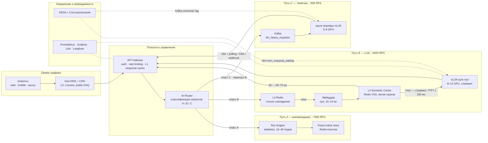
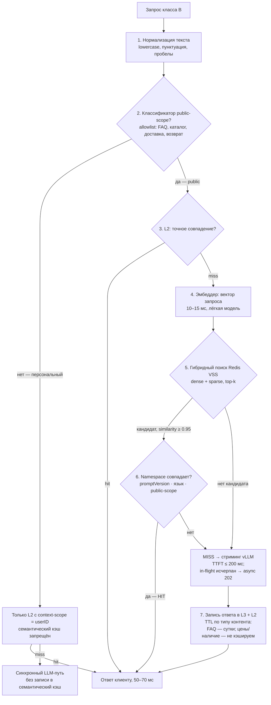
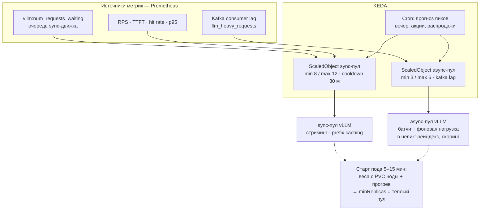
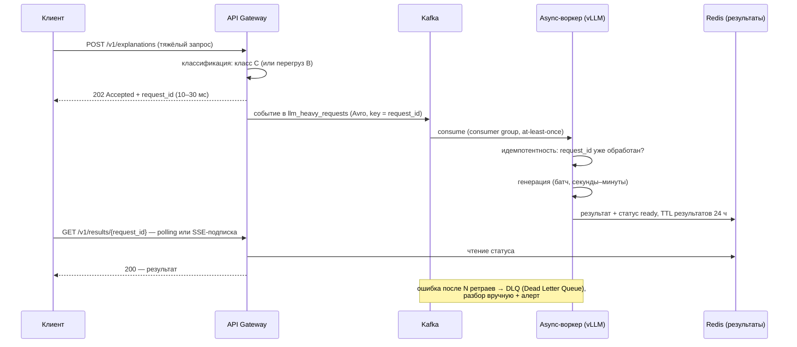
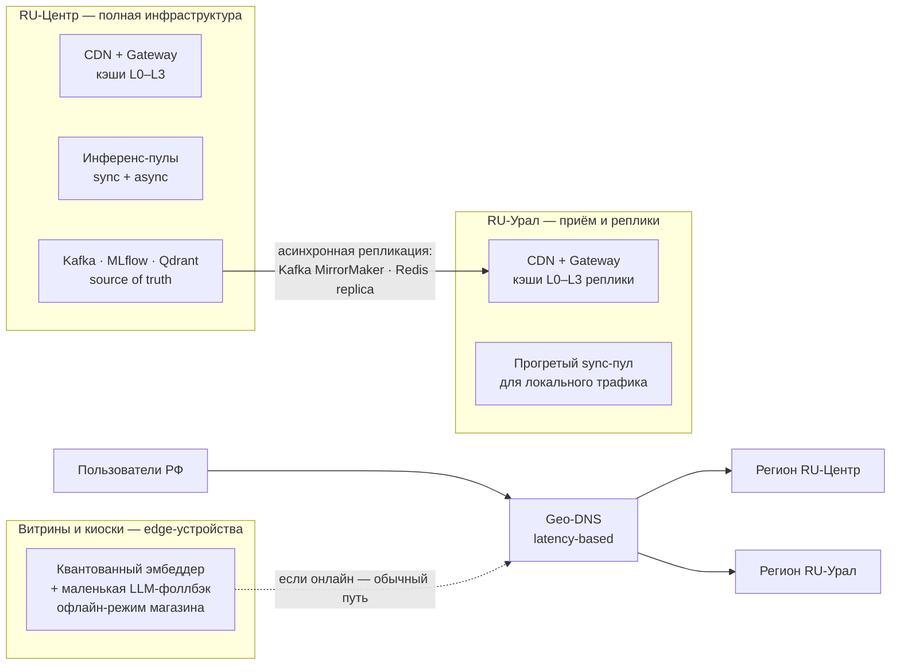

# High-Load и Low-Latency архитектура AI-сервиса TechnoMart

**Кейс:** TechnoMart — омниканальный ритейлер; AI Recommendation Service с RAG-контуром (RAG — Retrieval-Augmented Generation, генерация, дополненная поиском по базе знаний) генеративных объяснений рекомендаций.

**Задание:** сервис вырос — нагрузка 10 000 RPS (RPS — requests per second, запросов в секунду), требование Latency < 200 мс. Спроектировать архитектуру с кэшированием (включая Semantic Cache), горизонтальным масштабированием (KEDA) и асинхронной обработкой; опционально — гео-распределение (Geo-DNS, Edge computing).

---

## 0. Резюме

Архитектура строится на декомпозиции неоднородного трафика и каскаде кэшей:

- **Декомпозиция:** 10 000 RPS — это не одна нагрузка, а три класса с разным весом: лёгкие рекомендации (класс A, ~7 000 RPS), LLM-запросы (LLM — large language model, большая языковая модель) с семантическим кэшем (класс B, ~2 500 RPS) и тяжёлые генеративные запросы (класс C, ~500 RPS). Смешивать их в одном пуле нельзя — у LLM-инференса запросы различаются по стоимости на порядки.
- **Caching Strategy:** каскад L0 CDN → L1 API Gateway → L2 Redis (точное совпадение) → L3 Semantic Cache (эмбеддер + векторный поиск в Redis) + prefix caching внутри vLLM. Целевой hit rate семантического кэша ≥ 60% на классе B снижает нагрузку на LLM суммарно вдвое: с 3 000 до ~1 500 RPS (−50%).
- **Scaling:** KEDA (Kubernetes Event-Driven Autoscaling, автоскейлер Kubernetes по событийным метрикам) по реальной очереди движка `vllm:num_requests_waiting` для sync-пула и по Kafka lag для async-пула, поверх тёплого пула и расписания пиков. Модель реалистичная: реактивное масштабирование GPU-пулов не успевает за короткими всплесками — те принимает на себя управляемая деградация (§4.5).
- **Async Processing:** тяжёлые запросы (класс C и перелив при перегрузе класса B) уходят в Kafka (queue-based): клиент получает `202 Accepted + request_id` за десятки миллисекунд, результат — по polling/SSE/webhook (SSE — Server-Sent Events, серверные события по HTTP).
- **Latency < 200 мс** трактуется по путям: полные ответы — только на кэш-попаданиях (~50–70 мс); LLM-miss — стриминг с SLA по TTFT (TTFT — time to first token, время до первого токена); тяжёлое — асинхронно. Оговорим это сразу: полный генеративный ответ за 200 мс при такой нагрузке не получить.
- Инфраструктура: Yandex Cloud, Kubernetes, закрытый контур 152-ФЗ (закон «О персональных данных»), self-hosted LLM (vLLM).

### Матрица соответствия критериям оценки

| Критерий | Где в решении |
|---|---|
| **Адекватность мер:** Semantic Cache реально снижает нагрузку на LLM | §3.3 — арифметика «до/после»: 3 000 → 1 500 RPS при hit 60%; таблица чувствительности hit rate; guardrails от ложного кэширования (§3.5) |
| **Масштабируемость:** решение выдержит рост нагрузки | §4.4 — таблица ёмкости (пулы, GPU, stateless-поды); §4.5 — burst-playbook на всплеск x3; §1.2 — чувствительность к долям трафика |
| **Latency:** меры направлены на снижение задержек | §1.3 — latency-бюджет по путям; каждый уровень кэша §3.1 снижает свою долю; Geo-DNS/edge — §6 |

---

## 1. Контекст и допущения

### 1.1. Исходные условия

- **Сервис:** AI Recommendation Service (гибрид collaborative filtering + rules), исторически p95 < 200 мс на горячем пути; RAG-объяснения `GET /v1/explanations`; API отдаёт `modelVersion` — готовая опора для инвалидации кэша.
- **Стек:** Kubernetes в Yandex Cloud; Redis (Feast online store — хранилище онлайн-фич); Kafka (топики user_events, orders_cdc); Qdrant self-hosted (векторная БД для RAG-поиска); MLflow Model Registry (версии моделей и промптов); наблюдаемость — Prometheus + Grafana + Loki + Langfuse; деплой — Argo Rollouts (canary), веса моделей подтягиваются в рантайме с кэшем на PVC (PVC — PersistentVolumeClaim, постоянный том Kubernetes).
- **Ограничения:** закрытый контур 152-ФЗ (персональные данные не покидают контур, LLM только self-hosted); команда 2–3 ML-инженера; GPU-парк уже закуплен с запасом; «динамического облака GPU», где карты выдаются по щелчку, в российских реалиях нет.

### 1.2. Декомпозиция трафика и чувствительность к допущениям

Нагрузка 10 000 RPS раскладывается на классы (неравный вес запросов — ключевой факт LLM-инференса: короткий вопрос и генерация отчёта различаются по стоимости на 2–3 порядка):

| Класс | Что это | Доля | RPS | SLA | Путь |
|---|---|---|---|---|---|
| A | Рекомендации: скоринг фичей + правила, кэшируется по пользователю/контексту | ~70% | 7 000 | p95 < 200 мс (полный ответ) | sync |
| B | LLM-объяснения и FAQ-вопросы: короткие промпты и ответы, семантически повторяемые | ~25% | 2 500 | p95 < 200 мс на кэш-попадании; miss — TTFT ≤ 200 мс, стриминг | sync + Semantic Cache |
| C | Тяжёлая генерация: длинные промпты/ответы, сводные отчёты | ~5% | 500 | секунды–минуты | async (queue-based) |

Доли — допущение, проверяемое метриками прода. Чувствительность к нему (формула sync-нагрузки на LLM: `total × доля B × (1 − hit rate)`):

| Сценарий долей | B, RPS | hit 60% → sync LLM | hit 20% → sync LLM | Потолок sync-пула |
|---|---|---|---|---|
| 70/25/5 (базовый) | 2 500 | 1 000 | 2 000 | 2 400 (12 подов × 200) |
| 50/40/10 (пессимистичный) | 4 000 | 1 600 | 3 200 — выше потолка | 2 400 |

Из таблицы видно: при пессимистичных долях и низком hit rate sync-пул упирается в потолок — тогда срабатывает admission control и перелив miss-ов в async (§4.3, §4.5); сценарий отработан в архитектуре заранее, на проде он не должен стать сюрпризом.

### 1.3. Latency-бюджет по путям

Требование «Latency < 200 мс» раскладывается по путям — каждый со своим бюджетом:

| Путь | Составляющие | Бюджет |
|---|---|---|
| A, hit кэша L1/L2 | edge 20 + gateway 5 + Redis 2 + скоринг 20–40 + сеть | ~50–90 мс |
| B, hit L2/L3 (semantic) | edge 20 + gateway 5 + нормализация 2 + эмбеддер 10–15 + векторный поиск 10 + выборка 2 | <br/>~50–70 мс |
| B, miss → стриминг | всё выше + prefill-фаза LLM (прогон промпта) | TTFT p95 ≤ 200 мс — на границе; полный ответ идёт стримингом после первого токена, вне жёсткого бюджета |
| C, async | приём + постановка в очередь | 202 за 10–30 мс; результат — секунды/минуты по контракту |

Прямое прочтение «полный LLM-ответ за 200 мс при 10 000 RPS» физически недостижимо: итеративная генерация ~100 токенов под нагрузкой занимает секунды. Поэтому SLA класса B по miss перенесён на TTFT — время до первого токена; именно его пользователь ощущает как отзывчивость сервиса. TTFT-бюджет держится на двух рычагах: prefix caching повторяющихся префиксов RAG-промпта (prefill-фаза, которая и формирует TTFT, не пересчитывается — §3.1) и admission control (§4.3), не дающий очереди движка расти.

---

## 2. Общая архитектура

D1. High-Load архитектура AI-сервиса TechnoMart



Поток запроса: клиент → Geo-DNS/CDN → API Gateway (аутентификация, rate limiting, L1) → AI Router классифицирует запрос на A/B/C. Класс A идёт в stateless-скоринг с Feast/Redis. Класс B проходит каскад кэшей L2 → L3; на miss — стриминг из sync-пула vLLM, при перегрузе — перелив в очередь. Класс C сразу в Kafka. KEDA масштабирует пулы по метрикам; всё наблюдается в Prometheus/Langfuse.

---

## 3. Раздел 1. Caching Strategy

### 3.1. Каскад кэшей: где и что кэшируем

| Уровень | Где | Что кэширует | Ключ | TTL / инвалидация |
|---|---|---|---|---|
| L0 | CDN (Content Delivery Network, сеть доставки контента) | статику фронтенда и только public-FAQ | URL | минуты; purge при релизе |
| L1 | API Gateway | идентичные GET публичных ручек | нормализованный URL + параметры | 1–10 с |
| L2 | Redis | ответы рекомендаций (класс A) и точные совпадения LLM-запросов | hash(нормализованный текст + context-scope + promptVersion); для персональных — context-scope = userID | 60–600 с |
| L3 | Semantic Cache: Redis + RediSearch VSS (Vector Similarity Search, поиск по векторной близости) | LLM-ответы по смыслу запроса | вектор запроса → top-k ближайших + метаданные | по типу контента (§3.4) |
| Движок | vLLM: KV-кэш + prefix caching | повторяющиеся префиксы (системный промпт RAG, шаблоны) | хэш префикса токенов | жизнь инстанса |

Персонифицированные ответы в CDN (L0) не кладутся никогда — ключ на пользователя в CDN бессмыслен и опасен утечками. L4/KV-кэш — не уровень каскада, а автоматическая оптимизация inference-движка: повторяющийся префикс (системный промпт + инструкция) не пересчитывается на каждом запросе — это напрямую снижает TTFT. Для локальности prefix caching запросы маршрутизируются на инстансы по хэшу префикса.

### 3.2. Алгоритм Semantic Cache

D2. Алгоритм работы Semantic Cache (путь B)



Пошагово:

1. **Нормализация** — приведение текста к канонической форме (регистр, пунктуация), чтобы разные написания одного вопроса дали один ключ/вектор.
2. **Классификатор public-scope (allowlist, первая линия защиты).** В семантический кэш разрешён к попаданию только публичный контент: FAQ, каталог, условия доставки/возврата. Персональные запросы («где мой заказ», «какая у меня скидка») в L3 не идут и не записываются — иначе одинаковый вопрос получит чужой персонализированный ответ. Для них — только L2 с context-scope = userID.
3. **L2 — точное совпадение:** самый дешёвый lookup (~2 мс) снимает часть трафика до эмбеддера.
4. **Эмбеддер** — лёгкая модель строит вектор запроса. Эту цену платим на каждом запросе независимо от результата — потому кэш и окупается только при высоком hit rate.
5. **Гибридный поиск dense + sparse:** семантический (dense) поиск находит «какая столица у России» ≈ «где столица России», но не различает «тикер №123» и «тикет №124» — за это отвечает sparse-составляющая (точные совпадения идентификаторов/артикулов). Ищем top-k ближайших векторов в одном и том же Redis.
6. **Порог и namespace:** кандидат засчитывается как hit при косинусной близости ≥ 0.95 (порог — регулятор «hit rate ↔ качество»: шире порог — больше попаданий, но выше риск нерелевантного ответа) и при совпадении пространства имён: версия промпта, язык, public-scope.
7. **Запись на miss:** ответ LLM пишется в L3 и L2 с TTL по типу контента. Быстро устаревающее (цены, наличие, статус заказа) не кэшируется вовсе.

### 3.3. Арифметика: как Semantic Cache снижает нагрузку на LLM

Без кэша классы B + C дают на LLM: 2 500 + 500 = 3 000 RPS.

С каскадом (hit 60% на классе B; консервативно положим, что L1/L2 снимают ещё часть трафика):

| Метрика | Значение |
|---|---|
| B: sync-запросы в LLM после кэша | 2 500 × (1 − 0.60) = 1 000 RPS (стриминг) |
| C: async-запросы | 500 RPS (в очередь, вне sync-бюджета) |
| Итого на LLM | ~1 500 RPS — снижение на 50% |
| Чувствительность hit rate | 60% → 1 000 sync · 40% → 1 500 · 20% → 2 000 sync (потолок пула 2 400 — впритык, срабатывает admission control) |
| Цена кэша | эмбеддер + векторный поиск на все 2 500 RPS класса B (~10–25 мс на запрос) — при hit ниже ~20–30% кэш становится чистым оверхедом; метрика hit rate — под алертом (§7) |

Память L3: запись = эмбеддинг + текст ответа + метаданные ≈ сотни КБ → 100 тыс. записей ≈ десятки ГБ Redis — обычный масштаб кластера, лимитируется политикой eviction (вытеснения) по TTL/LRU (least recently used).

### 3.4. Инвалидация и version-grace

Простое решение «modelVersion в ключе» на практике не живёт: минорные ретрейны по дрифту идут почти ежедневно, и обнуление кэша на каждый релиз превращало бы сценарий «hit rate 0%» в рутину. Поэтому:

- Namespace кэша = promptVersion (хэш промпта/системного шаблона) + язык + scope, а не modelVersion целиком.
- Version-grace: минорный ретрейн (та же задача и промпт, метрики в допуске) кэш не сбрасывает — новые записи пишутся с новой версией, старые доживают свой TTL; отметка совместимости версий ставится в CI на golden set.
- Мажорный релиз (новая задача/промпт/несовместимая схема) — сброс namespace + режим холодного кэша: временный перелив miss-ов класса B в async (§4.5) и/или прогрев фоновым прогоном FAQ-корпуса на новом промпте до открытия канареечного трафика.
- TTL по типу контента: FAQ/справка — сутки; описания товаров — часы; цены/наличие/статусы — не кэшируем.

### 3.5. Guardrails и приватность

- Allowlist public-scope (шаг 2 алгоритма) — основная линия: в семантический кэш по определению не попадает персональное.
- Эвристика ПДн (персональных данных) — вторая линия: детектор телефонов/e-mail/номеров карт/«мой заказ» блокирует запись в L3 даже при ошибке классификатора.
- Никогда не кэшируем персонализированные ответы в общих namespace; L2-персональные записи изолированы context-scope = userID и коротким TTL.
- Проверка hit-ответа guardrails-фильтром (токсичность/ПДн) вынесена в фон — на критическом пути только блокирующие проверки из ДЗ-6.

### 3.6. Почему Redis VSS, а не отдельная векторная БД

L3 лежит на критическом по задержке пути (бюджет ~10–15 мс на поиск). Векторные БД общего назначения (Qdrant, Milvus) медленнее классических KV-сторов и в high-load проде требуют отдельного присмотра; Redis с RediSearch VSS даёт p99 поиска единицы миллисекунд на shard. Qdrant уже занят RAG-поиском по базе знаний — смешивать RAG-нагрузку и кэш-lookup в одном кластере значит получить noisy-neighbor (взаимное вытеснение нагрузок) для команды из 2–3 инженеров. Решение: L3 — отдельный Redis-кластер с VSS, кэш и поиск живут в разных хранилищах.

---

## 4. Раздел 2. Scaling: горизонтальное масштабирование inference-подов (KEDA)

### 4.1. Что вообще умеет масштабироваться, а что нет

Три факта, определяющие модель масштабирования:

1. Старт inference-пода — минуты, не секунды: загрузка весов (десятки ГБ) + прогрев шейпами = 5–15 минут даже с кэшем весов на PVC ноды. Реактивный автоскейл не успевает за коротким всплеском — он успевает за трендом (рост нагрузки на десятки минут).
2. GPU-парк конечен и закуплен запасом: maxReplicas ограничен железом, и это конкретное число — лимит закупленных карт (§4.4).
3. У vLLM есть собственная внутренняя очередь — её метрики видны в Prometheus, и это готовая «метрика очереди запросов» для KEDA, без изобретения новых очередей.

Модель масштабирования получается такой: тёплый пул (minReplicas) покрывает медиану; KEDA добирает поды по росту очереди на трендах; расписание — на прогнозируемые пики; короткие всплески достаются управляемой деградации (§4.5).

### 4.2. Разделение пулов и триггеры KEDA

Sync-пул (класс B) и async-пул (класс C) — отдельные деплойменты: батчевые async-воркеры не должны съедать бюджет 200 мс синхронного пути. Фоновой нагрузкой (переиндексация RAG, батч-скоринг) греются только async-пул и резерв — утилизация вместо простоя.

Фрагмент манифеста KEDA (полные values — Приложение А):

```yaml
apiVersion: keda.sh/v1alpha1
kind: ScaledObject
metadata:
  name: llm-sync-pool
spec:
  scaleTargetRef: { name: llm-sync }        # отдельный от async деплоймент
  minReplicas: 8                            # тёплый пул: медиана ~1000 RPS при 100–200 RPS/под
  maxReplicas: 12                           # потолок закупленных GPU
  cooldownPeriod: 1800                      # 30 мин: не сбрасывать прогретые поды
  triggers:
    - type: prometheus                       # реальная очередь движка vLLM
      metadata:
        query: sum(vllm:num_requests_waiting) # желаемые реплики = ceil(сумма очереди / threshold)
        threshold: "16"                      # очередь >16 на под → поднять ещё
    - type: prometheus
      metadata:
        query: sum(vllm:num_requests_running)
        threshold: "150"                     # насыщение по параллелизму
---
apiVersion: keda.sh/v1alpha1
kind: ScaledObject
metadata:
  name: llm-async-pool
spec:
  scaleTargetRef: { name: llm-async }
  minReplicas: 3
  maxReplicas: 6
  cooldownPeriod: 1800
  triggers:
    - type: kafka                            # метрика очереди для async
      metadata:
        topic: llm_heavy_requests
        consumerGroup: llm-workers
        lagThreshold: "500"
```

Границы min/max и пороги — калибровочные: minReplicas = 8 рассчитан от медианной sync-нагрузки ~1 000 RPS при вилке оценки 100–200 RPS/под (потребно 5–10 подов; берём середину с запасом на отказ одного инстанса — при консервативных 100 RPS/под шести подов медиана уже не покрывает). Точные значения min, порогов и RPS/под даёт нагрузочный тест на стенде — он обязателен до выставления порогов в проде (§4.4).

Stateless-компоненты (gateway, router, Rec Engine, эмбеддер) стартуют за секунды — им достаточно классического HPA (Horizontal Pod Autoscaler) по CPU/RPS. Cron-триггер KEDA поднимает minReplicas в известные пики (вечер, акции) — масштабирование по расписанию.

D3. Модель масштабирования



### 4.3. Admission control перед sync-пулом

Метрика очереди масштабирует пул, но не защищает уже летящие запросы: без ограничителя при перегрузе запросы копятся бесконечно. Поэтому перед sync-пулом стоит admission control:

- In-flight-лимит на инстанс (число параллельных стримов, выводится из ёмкости: ~параллелизм батчера vLLM) и на пул целиком.
- При исчерпании in-flight — запрос класса B не ждёт, а уходит по правилам burst-playbook (§4.5): перелив в async (`202 + request_id`) или, для некритичных, shed с `429` + `Retry-After`.
- Приоритеты: платный API-клиент > веб-витрина > анонимный трафик.

### 4.4. Таблица ёмкости (на 10 000 RPS)

| Компонент | Единица ёмкости | Расчёт | Инстансов | Железо |
|---|---|---|---|---|
| Gateway + Router + Rec Engine | ~500–1 000 RPS/под | 7 000–10 000 RPS + запас | 10–40 подов | CPU |
| Эмбеддер | ~500 RPS/под | 2 500 RPS класса B | 4–6 подов | CPU/общий GPU |
| Redis: Feast online | ~10 000 QPS кластер | 7 000 QPS класса A | кластер 3–6 шард | RAM |
| Redis VSS: L3 | ~5 000 QPS поиска | 2 500 QPS × всплеск x2 | отдельный кластер 3 шард | RAM |
| vLLM sync-пул | ~100–200 RPS/инстанс (короткие ответы, батчинг) | ≤ 1 000–2 000 sync RPS | 8–12 | GPU A100/H100 |
| vLLM async-пул | батчи, вне SLA | 500 RPS тяжёлых | 3–6 | GPU |
| Резерв (прогреваемый фоновой нагрузкой) | — | на всплески/отказы | 2–3 | GPU |
| Итого GPU | | | 13–21 (план ~18) | парк ~20 карт, включая резерв |

Оценка RPS на инстанс vLLM — инженерная (короткие ответы класса B, батчинг, prefix caching); точное число даёт нагрузочное тестирование на стенде — и оно же калибрует пороги KEDA.

Оценим реальную ёмкость async-контура. Средняя тяжёлая генерация длится десятки секунд (допущение ~30 с). По закону Литтла мгновенное обслуживание 500 RPS потребовало бы ~15 000 параллельных генераций — недостижимо ни на каком разумном пуле. Реальная пропускная способность — ~1–3 тяжёлых запроса/с на инстанс (выход ~1 000 токенов при ~1–3 тыс. токенов/с на инстанс), т.е. 3–6 инстансов ≈ 5–20 тяжёлых RPS. Поэтому класс C не обещает обслужить весь приток — это очередь с квотами: пер-клиентские квоты на постановку, SLA через время ожидания (метрика — Kafka lag), алерт на устойчивый рост лага с эскалацией бизнесу. Класс C деградирует по времени, а не обслуживается целиком; устойчивый приток тяжёлых, близкий к 500 RPS, — повод пересмотреть допущение долей (§1.2) и готовить отдельное обоснование закупки GPU. На практике приток тяжёлых на 1–2 порядка ниже пикового допущения — очередь их полностью сглаживает.

### 4.5. Burst-playbook: цепочка переживания всплеска x3 (30 000 RPS, 5 минут)

Старт пода 5–15 минут — значит всплеск такой длительности поглощается деградацией, а не масштабированием. Явная цепочка (каждая ступень включается метрикой, выключается по откату метрики):

| # | Ступень | Триггер | Что происходит с запросом |
|---|---|---|---|
| 1 | Тёплый пул | базовое состояние | всё штатно, TTFT в норме |
| 2 | KEDA scale-up | очередь vLLM растёт (тренд) | поды поднимаются — успеют для тренда, не для пика |
| 3 | Rate limiting | RPS > лимита клиента/тарифа | лишнее отбивается 429 на edge; это же срезает нагрузку на кэш-тир (эмбеддер + Redis VSS рассчитаны на ~5 000 QPS = x2; ступень удерживает приток класса B в этой ёмкости) |
| 4 | Admission control → перелив | in-flight исчерпан | класс B miss → `202 + async`; класс C — и так async |
| 5 | Load shedding по приоритетам | очередь async растёт | анонимный трафик — 429, платный — живёт |
| 6 | Graceful degradation | TTFT > SLA устойчиво | LLM-объяснения заменяются шаблонными, рекомендации — дефолтными блоками: пользователь не остаётся без ответа |

Всплеск x3 в итоге выглядит так: класс A частично деградирует до дефолтных блоков, класс B частично уходит в 202, класс C просто ждёт дольше — его SLA «секунды–минуты» это допускает. Сервис продолжает отвечать; для GPU-инференса это нормальный уровень зрелости: прозрачно отмасштабироваться под пятиминутный x3 не выйдет ни на одном движке.

---

## 5. Раздел 3. Async Processing: очередь для тяжёлых запросов

Классификация на входе (лёгкая эвристика: длина промпта, тип задачи, таймбокс) разводит потоки: то, что не может уложиться в sync-бюджет, сразу становится событием в очереди, и тяжёлые запросы не занимают синхронный путь.

D4. Асинхронный контур (queue-based)



Контракт и гарантии:

- **Контракт:** `202 Accepted` с `request_id` мгновенно; результат — polling `GET /v1/results/{id}`, SSE-стрим или webhook (для B2B-клиентов — business-to-business, корпоративных заказчиков). Результаты хранятся в Redis с TTL 24 ч; стор результатов может содержать ПДн — изолированный Redis-инстанс, доступ только сервисной учётке гейтвея, шифрование — всё внутри закрытого контура.
- **Формат событий:** Avro (бинарный формат со схемой) + Schema Registry — сломанная схема не пройдёт в прод.
- **Доставка at-least-once** (как минимум один раз — дубли возможны) + идемпотентность воркера по request_id (таблица обработанных идентификаторов с окном очистки в Redis) — дубль не сгенерирует ответ дважды.
- **DLQ** — события, упавшие после N ретраев, уходят в отдельный топик для ручного разбора; заодно клиентский запрос не зависает навсегда — у него есть наблюдаемый статус и DLQ.
- **Kafka выбрана** как уже эксплуатируемый в TechnoMart брокер: лог с retention (хранением) позволяет переиграть события и не терять их при падении воркеров — тяжёлый запрос не исчезает, а ждёт починки.

---

## 6. Раздел 4. Global Distribution (опциональный пункт): Geo-DNS и Edge

D5. Гео-распределение (обзорно)



- Geo-DNS (latency-based) маршрутизирует клиента в ближний регион; L7-балансировщик (уровня 7 модели OSI — работает с HTTP-запросами) завершает TLS (Transport Layer Security — шифрование транспорта) и держит сессии.
- Региональный POP (point of presence, точка присутствия) держит реплики кэшей L0–L3 и прогретый sync-пул: основная доля запросов класса B (кэш-попадания) обслуживается локально — edge-кэш напрямую снижает latency.
- Source of truth (Kafka, MLflow, мастер Qdrant) один, репликация асинхронная: кэш-реплики можно терять и догонять — это кэш, а не БД.
- Привязка к GPU-парку: региональный инференс-пул не входит в базовый парк ~20 карт (§4.4) — гео-сценарий это расширение закупки с отдельным бюджетом (обоснование: доля класса B из дальнего региона) либо активация из резерва; пока экономика не сошлась — сервис однорегиональный, а гео работает только на кэш-реплики (для hit-запросов это уже снижает latency).
- Edge computing — только там, где он обоснован: витрины/киоски магазинов с ненадёжным интернетом получают квантованные (сжатые с потерей точности) лёгкие модели — эмбеддер и маленький LLM-фоллбэк для офлайна. Полный LLM-инференс на edge не выносим: качество на слабых устройствах проседает, закупки не окупаются, а выигрыш в latency для онлайн-клиентов уже даёт региональный POP.
- Sticky-маршрутизация сессий по хэшу пользователя: стримингу и prefix caching выгодно попадать на тот же инстанс.

---

## 7. Отказоустойчивость и наблюдаемость

Паттерны (наследуются из общей практики отказоустойчивости): Retry с экспоненциальной задержкой и джиттером; Circuit Breaker на LLM-пул (не валить каскад); Timeout/дедлайн на каждый хоп; изоляция пулов (sync ≠ async); идемпотентность воркеров; graceful degradation как последняя ступень playbook (§4.5).

| Метрика | Порог алерта | Действие |
|---|---|---|
| hit rate L3 (окно 5 мин) | < 40% | playbook «холодного кэша»: проверить порог similarity, качество ответов, включить перелив miss-ов в async, поднять резерв |
| TTFT p95 (класс B) | > 200 мс | admission control жёстче, шаг playbook |
| p95 классов A/B | > 200 мс / > 70 мс | масштабирование/деградация по цепочке |
| vllm:num_requests_waiting | устойчивый рост > 5 мин | KEDA тренд + проверка потолка пула |
| Kafka lag async | > 10 000 | scale-up воркеров, алерт бизнеса |
| GPU saturation / tokens per second | деградация | расследование, резерв |
| Доля 429/202 | > 15% трафика | включился playbook — сообщить, следить за откатом |

Наблюдаемость: Prometheus (инфраструктура + метрики vLLM/KEDA), Grafana-дашборды по путям A/B/C, Loki-логи, Langfuse-трейсы LLM-вызовов с меткой `cache: exact-hit / semantic-hit / miss` — доля режимов видна в разрезе версий промпта, что закрывает и контроль version-grace (§3.4).

---

## 8. Ограничения и трейд-оффы (что мы сознательно не делаем)

1. **Serverless для горячего пути** — холодный старт несовместим с TTFT 200 мс, а цена при стабильной 24/7 нагрузке выше выделенных мощностей; serverless остаётся для песочниц экспериментов.
2. **Чистый HPA по CPU для GPU-пулов** — CPU-метрика догоняет уже случившийся всплеск; очередь движка (KEDA) сигнализирует раньше и точнее.
3. **Semantic Cache для персональных и быстро устаревающих ответов** — риск чужих ПДн и неактуальных ответов; решено allowlist'ом и TTL-политикой.
4. **Edge-инференс больших LLM** — качество квантованных моделей на слабых устройствах и экономика закупок; edge — только лёгкие фоллбэки.
5. **Распределённый шаринг KV-кэша между инстансами** — гонять гигабайты кэша по сети медленнее, чем пересчитать; вместо этого локальный prefix caching + маршрутизация по хэшу префикса.
6. **Гарантия «полный ответ < 200 мс» на miss** — за 200 мс не успеть: гарантируем TTFT и фиксируем это в SLA.
7. **«Бесконечное» автомасштабирование** — maxReplicas ограничен закупленным парком (≈20 карт, включая резерв); за пределом — управляемая деградация.


---

## 9. Словарь сокращений и терминов

| Сокращение / термин | Расшифровка |
|---|---|
| RPS / QPS | Requests / Queries Per Second — запросов в секунду |
| p50 / p95 / p99 | перцентили времени ответа (50/95/99% запросов быстрее этого значения) |
| SLA / SLO | Service Level Agreement / Objective — соглашение и целевой уровень качества сервиса |
| Latency | задержка обработки запроса |
| TTFT | Time To First Token — время до первого токена LLM-ответа |
| LLM | Large Language Model — большая языковая модель |
| RAG | Retrieval-Augmented Generation — генерация, дополненная поиском по базе знаний |
| Эмбеддер / эмбеддинг | модель, превращающая текст в вектор; числовое представление смысла текста |
| Dense / sparse векторы | плотный вектор смысла / разреженный вектор точных совпадений (ID, артикулы) — гибридный поиск |
| Косинусная близость / similarity | метрика похожести векторов (0–1); порог 0.95 — регулятор «hit rate ↔ качество» |
| VSS | Vector Similarity Search — поиск по векторной близости (RediSearch в Redis) |
| Semantic Cache | семантический кэш — кэш ответов по смыслу запроса (эмбеддер + векторный поиск) |
| Cache hit / hit rate | попадание в кэш / доля попаданий |
| TTL | Time To Live — время жизни записи |
| TLS | Transport Layer Security — протокол шифрования транспорта (HTTPS) |
| L7 | уровень 7 модели OSI (прикладной): балансировка/маршрутизация по HTTP-запросам |
| B2B | Business-to-Business — корпоративные клиенты |
| CPU / RAM | центральный процессор / оперативная память |
| LRU / eviction | вытеснение наименее недавно использованных записей при нехватке памяти |
| Инвалидация кэша | актуализация/сброс устаревших записей |
| CDN | Content Delivery Network — сеть доставки контента ближе к клиенту |
| Geo-DNS | DNS-балансировка по геолокации/задержке клиента |
| Edge computing / POP | вычисления ближе к клиенту / точка присутствия |
| API Gateway | единая входная точка API: аутентификация, лимиты, маршрутизация |
| Rate limiting | ограничение частоты запросов (защита от перегрузки и DDoS) |
| Load shedding | сбрасывание некритичных запросов при перегрузке (429) |
| Admission control | контроль допуска запросов в перегруженный пул (in-flight-лимит) |
| In-flight requests | обрабатываемые прямо сейчас запросы |
| Graceful degradation | плавная деградация: частичные ответы вместо полного отказа |
| Retry / Circuit Breaker / Fallback | повтор попытки / «выключатель» от каскадных сбоев / запасное поведение |
| Идемпотентность | повторная обработка не меняет результат (защита от дублей) |
| KEDA | Kubernetes Event-Driven Autoscaling — автоскейлинг по внешним метрикам (очереди) |
| HPA | Horizontal Pod Autoscaler — штатный автоскейлер Kubernetes по CPU/метрикам |
| min/maxReplicas | нижняя (тёплый пул) / верхняя (потолок железа) границы числа подов |
| Тёплый пул | постоянно прогретые инстансы, готовые к трафику |
| Прогрев модели | разогрев inference прогонами данных после старта |
| Под (pod) | минимальная единица развёртывания в Kubernetes |
| PVC | PersistentVolumeClaim — постоянный том Kubernetes (кэш весов на ноде) |
| vLLM | inference-движок LLM с батчингом и paged KV-кэшем |
| Triton Inference Server | промышленный inference-движок NVIDIA с батчеванием |
| KV-кэш | кэш attention-тензоров промпта внутри LLM-движка; переиспользуется при генерации |
| Prefix caching | переиспользование KV-кэша повторяющихся префиксов (системный промпт) |
| Prefill / Decode | фазы LLM: прогон промпта (нагружает вычисления) / генерация токенов (нагружает память) — TTFT = prefill |
| Батчинг / батч | группировка запросов для совместной обработки — выше пропускная способность GPU |
| GPU | Graphics Processing Unit — вычислитель для инференса моделей |
| А100 / H100 | модели NVIDIA GPU серверного класса |
| Квантование | сжатие модели с понижением разрядности весов ценой качества |
| Kafka | распределённый брокер сообщений (лог с хранением — retention) |
| Consumer lag | отставание обработчиков от конца очереди Kafka |
| DLQ | Dead Letter Queue — очередь для сообщений, не обработанных после N попыток |
| At-least-once | гарантия доставки «как минимум один раз» (дубли возможны) |
| Avro / Schema Registry | бинарный формат событий со схемой / реестр схем |
| Pub/Sub | публикация-подписка: событие получают все подписчики |
| SSE | Server-Sent Events — стриминг событий сервера клиенту по HTTP |
| Webhook / Polling | обратный вызов по HTTP / периодический опрос результата |
| Redis / RediSearch | in-memory хранилище ключ-значение / его модуль поиска (VSS) |
| Qdrant | векторная БД (в TechnoMart — RAG-поиск по базе знаний) |
| Feast | feature store — хранилище признаков (offline/online) |
| MLflow Model Registry | реестр версий моделей и артефактов |
| Argo Rollouts | прогрессивные релизы (canary) в Kubernetes |
| Canary-релиз | выкатка на малую долю трафика с анализом метрик |
| Golden set | контрольный набор вопросов/кейсов для проверки качества |
| Langfuse | трейсинг и наблюдаемость LLM-приложений |
| Prometheus / Grafana / Loki | сбор метрик / дашборды / логи |
| ПДн | персональные данные (152-ФЗ — закон «О персональных данных» РФ) |
| Public-scope | неперсонализированный контент, разрешённый к семантическому кэшированию |
| Allowlist | белый список того, что разрешено (здесь: контент, попадающий в Semantic Cache) |
| Noisy neighbor | взаимное вытеснение нагрузок на общем ресурсе |
| Burst | короткий всплеск нагрузки |
| CI | Continuous Integration — непрерывная интеграция (сборка/тесты) |
| DDoS | Distributed Denial of Service — распределённая атака отказом в обслуживании |
| 202 Accepted / 429 Too Many Requests | HTTP-коды: запрос принят в обработку (асинхронно) / лимит запросов превышен |

---

## Приложение А. Полный манифест KEDA ScaledObject

Дополняет фрагмент §4.2 обязательными параметрами триггеров (`serverAddress` у prometheus-триггера, `bootstrapServers` у kafka-триггера) и `activationThreshold` против «дребезга» масштабирования на малой очереди:

```yaml
apiVersion: keda.sh/v1alpha1
kind: ScaledObject
metadata:
  name: llm-sync-pool
  namespace: ai-inference
spec:
  scaleTargetRef:
    name: llm-sync                 # отдельный от async деплоймент
  minReplicas: 8                   # медиана ~1000 RPS при 100–200 RPS/под (калибруется НТ)
  maxReplicas: 12                  # потолок закупленных GPU
  cooldownPeriod: 1800             # 30 мин: не сбрасывать прогретые поды
  triggers:
    - type: prometheus
      metadata:
        serverAddress: http://prometheus.monitoring.svc:9090   # обязательный параметр
        query: sum(vllm:num_requests_waiting{pool="sync"})     # желаемые реплики = ceil(очередь / threshold)
        threshold: "16"
        activationThreshold: "8"   # ниже — не дёргать масштабирование
    - type: prometheus
      metadata:
        serverAddress: http://prometheus.monitoring.svc:9090
        query: sum(vllm:num_requests_running{pool="sync"})     # насыщение по параллелизму
        threshold: "150"
---
apiVersion: keda.sh/v1alpha1
kind: ScaledObject
metadata:
  name: llm-async-pool
  namespace: ai-inference
spec:
  scaleTargetRef:
    name: llm-async
  minReplicas: 3
  maxReplicas: 6
  cooldownPeriod: 1800
  triggers:
    - type: kafka
      metadata:
        bootstrapServers: kafka-bootstrap.streaming.svc:9092    # обязательный параметр
        topic: llm_heavy_requests
        consumerGroup: llm-workers
        lagThreshold: "500"
```
