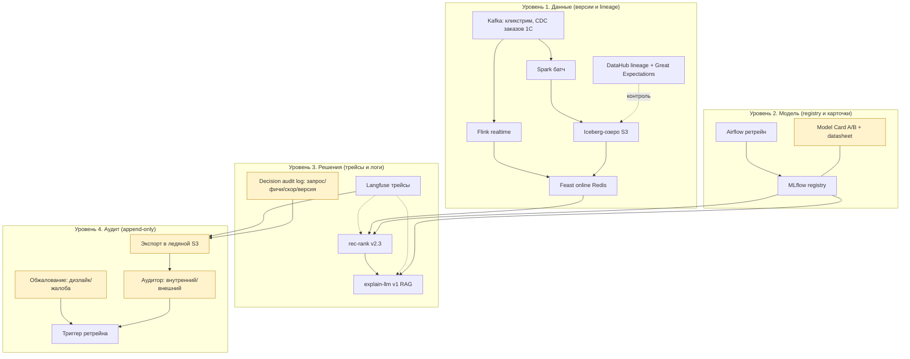
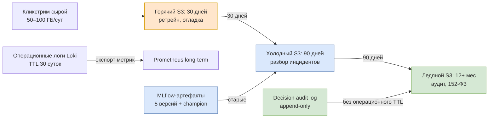
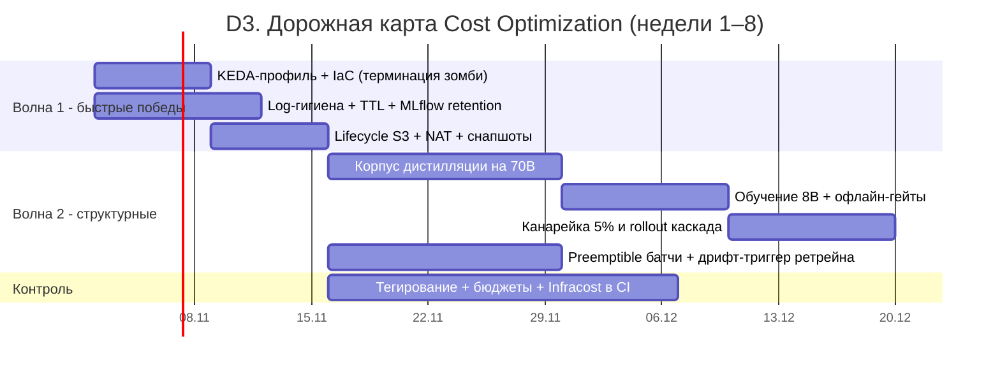

# FinOps и Governance: Model Card и Cost Optimization для TechnoMart

> **Кейс:** «TechnoMart» - интеллектуальная система рекомендаций для омниканального ритейлера 
> бытовой техники и электроники.
> 
> **Цель работы:** разработать Model Card (карточку модели) для AI-системы TechnoMart и план 
> оптимизации облачных затрат с анализом превышения бюджета на 50%.
> 
> **Задание:** 
> - Часть 1 Governance - Model Card (назначение и ограничения, анализ данных 
> и предвзятости, метрики справедливости);
> - Часть 2 FinOps - анализ причин перерасхода и план 
> Cost Optimization (Spot Instances, Model Distillation, TTL для данных).

---

## 0. Резюме и матрица соответствия критериям

**Ключевые решения:**

- **Две карточки модели.** Основная - гибридная ранжирующая модель рекомендаций (ядро бизнес-ценности AOV (Average Order Value, средний чек) и главный носитель рисков предвзятости); вторая - LLM (Large Language Model, большая языковая модель) объяснений рекомендаций в RAG-контуре (главный источник затрат на GPU и репутационных рисков галлюцинаций). Вспомогательные лёгкие модели (эмбеддер, классификатор роутера, детектор токсичности) выведены за скоуп карточек - они покрыты мониторингом и guardrails (защитными механизмами поверх модели).
- **Fairness (справедливость) операционализирована для рекомендаций:** паритет CTR (Click-Through Rate, доля кликов) и HitRate@10 между сравнимыми сегментами returning-пользователей, Catalog Coverage и доля long-tail (непопулярных) товаров как метрики популярностного смещения; для новых пользователей - относительный минимум качества вместо жёсткого паритета. Прямой перенос TPR/FPR (True/False Positive Rate) из бинарной классификации неприменим - нет негативной разметки.
- **Финансовая модель перерасхода:** базовый бюджет облака 4,50 млн ₽/мес (8 GPU в резервации + 5 GPU эластичных + прикладной стек), фактический счёт 6,75 млн ₽ (+50%, +2,25 млн). Каждая причина перерасхода разложена в рублях до арифметики «карты × часы × тариф».
- **Двухволновой план Cost Optimization:** волна 1 (быстрые победы, недели 1–2) устраняет весь перерасход (−2,25 млн ₽/мес) и выполняется в основном настройкой конфигурации; волна 2 (структурные меры, недели 3–8) - каскадная дистилляция 70B>>8B (класс C на preemptible сразу, класс B - пересборка резервации 8>>6 карт на следующем цикле), preemptible-инстансы (прерываемые, аналог Spot) для батчей, переход ретрейна на триггер по дрифту - снижает базовый бюджет до 3,04 млн ₽/мес (−32%); сценарий без дистилляции - 4,28 млн ₽ (−4,9%). Миграция в Cloud.ru разобрана в сценарии с окупаемостью и отложена (§8.5).
- **Governance-контур (4 уровня: данные >> модель >> решения >> аудит) описан поверх уже спроектированных компонентов** без дублирования: decision audit log (журнал решений) с 4 обязательными полями, разграничение операционного TTL (Time To Live, срок жизни) логов и бессрочного аудиторского слоя.

**Матрица соответствия критериям оценки:**

| Критерий | Где в документе |
|---|---|
| Этика: Model Card заполнен по стандарту, риски предвзятости осознаны | §2–4 (две карточки по шаблону Mitchell et al. / Hugging Face), §3.2 (bias-анализ), §3.4/§4.4 (митигация по этапам «до/во время/после»), §5 (governance-контур) |
| Экономика: конкретные технические меры снижения затрат | §6–8: KEDA-профили, выключение забытых GPU, lifecycle/TTL хранилищ, дистилляция, preemptible, дедупликация, Infracost в CI - с эффектом в ₽ и окупаемостью |
| Зрелость: баланс между ценой и качеством | §8.6 (гейты качества при дистилляции), §9 (что сознательно не оптимизируем), §9.3 («три вопроса архитектора») |

---

## 1. Контекст системы и базовая линия стоимости

### 1.1. Краткий контур системы

Из прошлых работ: рекомендательный сервис вынесен за пределы монолита Bitrix (PHP/MySQL); события кликстрима и заказы 1С через Kafka и CDC (Change Data Capture, захват изменений данных) попадают в озеро S3 + Apache Iceberg; realtime-фичи - Flink >> Redis (Feast online store), батч-агрегаты - Spark; ранжирование - гибрид collaborative filtering (коллаборативная фильтрация) + rule-based; объяснения - self-hosted LLM под vLLM с RAG (Retrieval-Augmented Generation, генерация с дополнением поиском) по каталогу в Qdrant. Observability: Prometheus/Grafana, Loki, Langfuse. SLA (Service Level Agreement) горячего пути - p95 < 200 мс при 10 000 RPS (Requests Per Second, запросов в секунду); цель бизнеса - AOV +10%; команда - 2–3 ML-инженера; контур закрытый (152-ФЗ, закон РФ «О персональных данных»).

### 1.2. Модель владения инфраструктурой и преемственность с прошлыми работами

В прошлых работах параметры инфраструктуры эволюционировали; для финансовой модели фиксируем одну непротиворечивую версию и объясняем выбор.

| Параметр | sizing LLM | CI/CD | High-Load | Принято в этой работе                                                                                                                          | Почему |
|---|---|---|---|----------------------------------------------------------------------------------------------------------------------------------------------------|---|
| Облако | Расчёт: Yandex и Cloud.ru | Yandex Cloud | Yandex Cloud | Yandex Cloud (прод), Cloud.ru - сценарий миграции §8.5                                                                                         | Закрытый контур уже развёрнут в Yandex; сравнение провайдеров сохраняет ценность |
| GPU-парк | 5×A100-80 (план INT4) | 1–2 GPU-ноды | 13–21 карта (sync 8–12, async 3–6, резерв 2–3) | 8 карт sync - резервация (committed use, скидка ~30%), async 3 + резерв 2 - эластичные on-demand/preemptible, пики распродаж +4 карты ≤10 дней | Постоянную базовую нагрузку выгоднее держать в резервации; эластичную часть - платить по факту; резервы и батчи - на прерываемых инстансах |
| Тарифы A100-80 | Yandex 472 ₽/ч, Cloud.ru 317 ₽/ч, preemptible 188,68 ₽/ч (НДС включён) | - | - | 472 / 330 (резервация −30%) / 189 ₽/ч                                                                                                          | Все эффекты §7–8 считаются в этих тарифах |

### 1.3. Базовый бюджет месяца (план)

Статьи выведены из конфигурации и тарифов предыдущих работ; месяц = 730 ч. Это допущение-модель учебного кейса: цифры калибруются по биллингу реального проекта.

| Статья | Расчёт | ₽/мес |
|---|---|---|
| GPU sync-пул, 8 карт A100-80 (резервация 330 ₽/ч) | 8 × 730 × 330 | 1 927 000 |
| GPU async-пул, 3 карты on-demand (472 ₽/ч) | 3 × 730 × 472 | 1 034 000 |
| GPU резерв, 2 карты preemptible (189 ₽/ч) | 2 × 730 × 189 | 276 000 |
| GPU пики распродаж (сверх sync-базы, план: +4 карты × 10 дней) | 4 × 240 × 472 | 453 000 |
| GPU dev/stress-стенды, preemptible (план ~195 ч × 3 карты) | 3 × 195 × 189 | 110 000 |
| GPU батч-ретрейн и reindex Qdrant, preemptible | ~317 ч × 189 | 60 000 |
| K8s CPU-ноды 6 × (8 vCPU / 32 ГБ) | 6 × ~20 000 | 120 000 |
| Redis: online store (6 шард) + VSS (Vector Similarity Search, 3 шард) | по прайсу | 200 000 |
| Managed PostgreSQL (MLflow/Airflow) + Registry + Lockbox | по прайсу | 100 000 |
| S3-озеро план: ~20 ТБ горячий класс (2,2 ₽/ГБ) | 20 000 × 2,2 | 44 000 |
| Egress/NAT план | по прайсу | 80 000 |
| Observability и аналитика логов: Loki/Tempo/MLflow-тома, Langfuse, Managed ClickHouse (базовый кластер операционной аналитики логов) | по прайсу | 100 000 |
| Итого базовый бюджет | | ≈ 4 500 000 |

Фактический счёт месяца: 6,75 млн ₽ - превышение +2,25 млн ₽ (+50%). Разбор - §6.

---

# Часть 1. Governance: Model Card

## 2. Скоуп карточек и стандарт оформления

Стандарт - четыре блока по Mitchell et al., «Model Cards for Model Reporting» (arXiv 1810.03993), ставшие де-факто стандартом Hugging Face: (1) назначение и ограничения; (2) данные и анализ предвзятостей; (3) метрики качества (evaluation); (4) этические риски, владелец и контакты.

Карточки ведутся для двух моделей, непосредственно влияющих на пользователей:

| Модель | Роль в системе | Почему карточка нужна |
|---|---|---|
| **A. Ранжирующая модель рекомендаций** `rec-rank v2.3 (champion@v47)` | Отбор и порядок товаров в блоках рекомендаций на всех страницах | Ядро бизнес-ценности (AOV), покрывает всех 2 млн MAU (Monthly Active Users, активных пользователей в месяц), еженедельный ретрейн - главный носитель рисков предвзятости |
| **B. LLM объяснений** `explain-llm v1 (Llama-3-70B, INT4 AWQ)` | Генерация коротких текстов «почему рекомендуем» в RAG-контуре | Главный драйвер GPU-затрат (связка с Частью 2) и репутационных рисков (галлюцинации, токсичность) |

Вспомогательные модели (эмбеддер товаров, эмбеддер semantic cache, классификатор AI Router, детектор инъекций и токсичности, judge-модели Ragas/DeepEval) карточек не получают: они либо не формируют пользовательский контент напрямую, либо работают внутри guardrails. Они включены в ownership matrix (§5.4) и покрыты мониторингом. Это осознанное ограничение скоупа - карточка имеет смысл там, где модель принимает решение или генерирует текст для пользователя.

## 3. Model Card A. Ранжирующая модель рекомендаций

### 3.1. Назначение и ограничения (Intended Use & Limitations)

**Идентификация:** `rec-rank v2.3 (champion@v47)`, гибрид collaborative filtering + rule-based, realtime re-ranking поверх precomputed-кандидатов; фичи Feast (кликстрим-окна 5 мин/1 ч, агрегаты 30/90 дней, история заказов 1С). Ретрейн еженедельный по расписанию (переход на триггер по дрифту - мера §8.3).

**Назначение (intended use):**

- персональный подбор и порядок товаров в блоках рекомендаций сайта и мобильного приложения (страницы: главная, карточка товара, корзина, поиск, checkout) для залогиненных пользователей;
- цель - увеличение AOV на 10% (подтверждение A/B-тестом), прокси-метрика - CTR блока рекомендаций (базовый уровень 0,5%);
- ассортимент - каталог 1С (1–5 млн SKU): бытовая техника и электроника;
- аудитория - покупатели ритейлера TechnoMart: жители РФ, 18+, русскоязычный интерфейс;
- режим работы: полностью автоматический, без оператора; fallback при холодном старте - «популярное в категории» (код причины `cold_start_popular`).

**Ограничения (что модель делать не должна - out of scope):**

- не инструмент динамического ценообразования и не прогноз спроса/закупок (цена и остатки - только входные признаки из 1С);
- не принимает решений с юридическими последствиями (кредитование, скоринг людей, найм) и не используется вне домена товаров каталога;
- не рассчитана на юрисдикции и языки, кроме РФ и русского (данные и каталог только РФ);
- не гарантирует качество на товарах-новинках без истории взаимодействий и в первые минуты после публикации каталога (дельта 1С подгружается каждые 15 минут);
- коммерческие платные размещения в блоках не участвуют в ранжировании текущей версии; если бизнес введёт спонсорские позиции - они будут размечены в интерфейсе и исключены из метрик справедливости, чтобы буст не читался как необнаруженная предвзятость.

**Edge-кейсы (сценарии, на которых модель сознательно не обучалась):**

- распродажи и флеш-акции: ассортимент и поведение резко меняются, качество падает до стабилизации фич (окна 5 мин/1 ч сглаживают частично);
- офлайн-покупатели: их покупки попадают в данные с задержкой синка 1С (до 15 минут), персонализированное исключение купленного работает с этой же задержкой;
- пользователи-боты и скрипты: отфильтровываются на этапе Flink-сессионализации, но сложная имитация поведения остаётся в данных.

### 3.2. Данные обучения и анализ предвзятости (Bias analysis)

| Параметр | Значение |
|---|---|
| Источники | Кликстрим web+mobile (просмотры, клики, корзина, поиск) ~50–100 ГБ/сут сырых событий; заказы из 1С через CDC (тысячи заказов в час); каталог 1С (снапшот раз в сутки, дельта каждые 15 мин) |
| Период | История заказов - ~12 месяцев (допущение: доступный объём на момент обучения); кликстрим - с момента развёртывания сбора событий на PoC, ~6 месяцев |
| Объём обучающей выборки | Агрегаты фич 30/90 дней и окна 5 мин/1 ч; точное число пар «пользователь–товар» - допущение, калибруется при ретрейне |
| Разметка | Явной разметки нет: обучение на неявных сигналах (клик, добавление в корзину, заказ); негативные сигналы (показ без клика) шумные - негативная разметка отсутствует |
| Train/test split | Временной holdout: последняя неделя до среза обучения; стратификация по категориям каталога и сегментам пользователей |
| Исключённые признаки | Пол, возраст и иные демографические атрибуты не собираются вовсе (минимизация по 152-ФЗ); user_id - псевдонимизированный хэш |
| Предобработка | Бот-фильтр и дедупликация в Flink; DQ-гейты Great Expectations между слоями озера |

**Известные перекосы выборки (bias):**

1. **Залогиненные vs анонимные.** Модель обучена на авторизованных пользователях (PoC шёл на 5–10% залогиненных, MVP - 100%); поведение анонимов покрыто косвенно. Анонимы получают rule-based fallback - предвзятость не в скорах, а в архитектуре обслуживания.
2. **Региональный перекос.** Основной объём взаимодействий - города-миллионники; регионы с низкой представленностью получают менее точные рекомендации (long-tail предпочтений региона не выучен).
3. **Популярностное смещение (popularity bias).** CF-компонент систематически усиливает товары с длинной историей взаимодействий; новые SKU и ниши без истории почти не показываются - эффект «богатые становятся богаче».
4. **Асимметрия офлайн/онлайн.** Покупатели, приобретающие преимущественно офлайн, представлены в данных только событиями онлайн-сессий и заказами, приходящими из 1С с задержкой.
5. **Демографическая слепота.** Пол/возраст не собираются: прямая дискриминация по этим признакам исключена конструктивно, но косвенные корреляции (категории товаров ↔ демографические группы) неизмеримы - зафиксировано как ограничение, план сбора обезличенных сегментов - §3.4.

### 3.3. Метрики качества и справедливости (Evaluation)

Для ранжирования рекомендаций прямого аналога FPR нет (нет негативной разметки «должен был не показать»), поэтому применяем стандартную адаптацию:

| Метрика | Адаптация для рекомендаций | Обоснование |
|---|---|---|
| recall / TPR | HitRate@10 / Recall@10 - доля сессий, где в топ-10 был полезный товар (клик/заказ) | HitRate@k - эмпирический аналог recall@k для ранжирования |
| FPR | не применяется; вместо неё - Catalog Coverage и доля long-tail SKU | Популярностное смещение - главный измеримый аналог «ложных срабатываний» рекомендателя: показываем популярное тем, кому оно не нужно |
| «одинаковые шансы по группам» | паритет HitRate/CTR между сравнимыми сегментами returning-пользователей | Сравнимы только сегменты с сопоставимой историей; жёсткий паритет new vs returning недостижим по природе холодного старта |

**Оффлайн-метрики качества (ретрейн-гейты, MLflow):** Recall@10 ≥ 0,08 и NDCG@10 (Normalized Discounted Cumulative Gain, качество порядка) ≥ 0,05 на holdout-неделе (пороги - допущения, калибруются на первом championset-замере; их стабильность между ретрейнами важнее абсолютных значений). Онлайн: CTR блока, конверсия, AOV - A/B-тестом против champion с bootstrap-статистикой.

**Метрики справедливости (еженедельная bias-панель Grafana):**

| Метрика | Группы | Порог (допущение до калибровки) |
|---|---|---|
| CTR блока рекомендаций | регионы: миллионники vs остальные, среди returning | паритет ±5 п.п. (алерт-триггер для расследования, не цель оптимизации) |
| HitRate@10 | web vs mobile, среди returning | паритет ±5 п.п. |
| HitRate@10 новых пользователей | new (≤14 дней жизни) | ≥ 50% уровня returning к 14-му дню (относительный минимум, а не паритет) |
| Catalog Coverage | доля активного каталога (SKU с ≥1 показом за неделю) | ≥ 30–40% |
| Доля long-tail | показы SKU вне топ-100 популярных за неделю | ≥ 15–20% |
| Recall@10 по категориям | 7 верхнеуровневых категорий каталога | отклонение от среднего ≤ 25% |

Пороги помечены как допущения: первое измерение задаёт baseline, после чего пороги фиксируются в модели-карте при ближайшем ретрейне (карточка обновляется при каждом переобучении - README/changelog модели). Важно: CTR-паритет - триггер расследования; «оптимизировать» его напрямую нельзя, иначе паритет будет достигнут деградацией качества во всех группах.

### 3.4. Этические риски, митигация и ответственность

**Риски:** популярностное смещение давит малые бренды и новинки (коммерческая несправедливость для поставщиков); региональный перекос - худшее качество для целых регионов; циклическое усиление стереотипов потребления (рекомендуем >> покупают >> рекомендуем сильнее); отсутствие демографии - невидимость косвенных перекосов.

**Митигация по этапам пайплайна:**

| Этап | Мера для rec-rank |
|---|---|
| До обучения | Oversampling/развесовка сегментов: регионы-немиллионники и новые пользователи; расширение выборки long-tail категорий |
| Во время обучения | Fairness-компонент в лоссе ранжирования (штраф за провал паритета Recall@10 по регионам/категориям); калибровка скоров по сегментам |
| После обучения | Rule-based floor: гарантированная доля long-tail и новых SKU в блоках; exploration-шум («рандомный score» - иногда показывать товар вне топа похожести); пороги с корректировкой по группам; guardrails поверх выдачи (фильтры наличия/возрастных ограничений) |

**Ответственность:** бизнес-овнер - директор по маркетингу TechnoMart (решает, «как должно быть»); ML-овнер - тимлид ML-команды; эксплуатация - on-call инженер (см. ownership matrix §5.4). Обжалование для пользователя - дизлайк на рекомендацию + жалоба в поддержку: дизлайк немедленно исключает товар из персональных блоков и попадает в выборку ретрейна (рост дизлайков +20% к базовой неделе - триггер пересмотра).

**План закрытия слепых зон:** пилот добровольного сбора обезличенных сегментов (регион/возрастная корзина по явному согласию, 152-ФЗ) - цель: измеримость косвенных демографических перекосов; до внедрения слепота зафиксирована как ограничение §3.2.

## 4. Model Card B. LLM объяснений рекомендаций

### 4.1. Назначение и ограничения

**Идентификация:** `explain-llm v1` - Llama-3-70B, квантование INT4 AWQ, инференс vLLM; RAG-контекст из Qdrant (эмбеддинги текстов каталога 1С), промпт-шаблоны версионированы (Prompt Template Factory, ключи кэша включают promptVersion). Дообучения нет - используем предобученную базу (векторная база и промпты версионируются и обновляются).

**Назначение:** генерация короткого объяснения блока рекомендаций («почему вам это подходит») строго на основе grounded-фактов каталога (название, атрибуты, цена, наличие из 1С); асинхронная ветка `GET /v1/explanations`, p95 ≤ 1,5 с; язык - русский.

**Ограничения:**

- не свободный чат и не вопросно-ответная система: только объяснение рекомендации по фиксированным шаблонам с подстановкой фактов;
- не консультации по безопасности эксплуатации техники, гарантии, ремонту - на эти темы отвечают статичные шаблоны;
- не источник цены и наличия: факты только из каталога; любой факт вне каталога блокируется валидатором;
- не для персональных данных: пользовательский ввод (контекст сессии) проходит PII-маскирование Presidio до промпта;
- вне РФ/русского языка модель не оценивалась.

**Edge-кейсы:** jailbreak-промпты («повтори за мной…», попытки вытащить системный промпт), косвенные инъекции через тексты карточек товаров, вопросы о товарах, отсутствующих в каталоге, смешанные языки.

### 4.2. Данные и анализ предвзятости

| Параметр | Значение |
|---|---|
| База | Llama-3-70B - публично предобученная модель; состав корпусов разработчиком полностью не раскрыт - наследованное смещение не контролируем, фиксируем как ограничение (стандартная ситуация для self-hosted LLM: «карточки открытых моделей почти не содержат этических блоков») |
| Контекст RAG | Тексты каталога 1С (1–5 млн SKU: название, описание, атрибуты); источник описаний - карточки поставщиков и контент-команда TechnoMart (смещения языка и стиля поставщиков наследуются) |
| Промпты | Шаблоны версионированы; аудиторские прогоны на канареечном наборе jailbreak/PII/инъекций |
| Дообучение | Отсутствует; векторная база переиндексируется при дельте каталога (15 мин) |

**Известные ограничения:** описания товаров пишут поставщики - стилистические и маркетинговые перекосы категорий переходят в объяснения; длинные/технические описания дают менее релевантный ретрив; русскоязычный корпус Llama-3 уступает англоязычному - качество объяснений для редких категорий может проседать.

### 4.3. Метрики качества и справедливости

Релизные гейты (Ragas/DeepEval, golden set ~100 кейсов в git, пороги): Faithfulness (верность фактам контекста) ≥ 0,90 (факт на мокапе - 0,93); Answer Relevancy ≥ 0,75 (факт 0,81); Context Precision ≥ 0,80; Context Recall ≥ 0,85; токсичность = 0 (абсолютный порог, не «паритет»); Valid JSON ≥ 99,5% (для API-потребителей); explain p95 ≤ 1,5 с.

**Валидация цены/наличия - детерминированная, не генеративная:** 100% ответов проходят жёсткую сверку чисел с каталогом 1С (SQL-проверка); расхождение >> ответ блокируется и замещается статичным шаблоном без фактов. Поэтому «100% валидность» - свойство конвейера, а не обещание качества LLM.

**Fairness-метрики LLM (панель):** паритет Faithfulness по 7 категориям каталога (отклонение ≤ 0,05 от среднего - допущение); доля блокировок валидатора по категориям (перекос >2× - сигнал смещённых описаний у поставщика категории); токсичность - ноль для всех сегментов (безусловный порог, мониторится по категориям товаров и типам запросов).

**Источник региональной сегментации для bias-панелей §3.3/§4.3:** псевдонимизированный гео-IP и регион доставки из 1С, агрегированные без привязки к user_id в чистом виде (данные уже собираются в контуре 152-ФЗ, отдельного сбора не требуется).

### 4.4. Этические риски, митигация и ответственность

**Риски:** галлюцинации характеристик/цены (критический риск); утечка ПДн (Personal Data, персональные данные) в логи и промпты; токсичный или оскорбительный текст; инъекции; «формальная дискриминация» стилем ответа.

| Этап | Мера для explain-llm |
|---|---|
| До (вход) | PII Sanitizer - Microsoft Presidio (NER + regex, российские детекторы паспорта/ИНН/карты): mask() до промпта, unmask() после; детектор инъекций на входе |
| Во время | Grounded-режим: генерация только по фактам контекста RAG; фиксированные шаблоны вместо свободной генерации |
| После | Output Guardrails: JSON-schema + детерминированная сверка цены/наличия с 1С; классификатор токсичности; Response Sanitizer (DLP, Data Loss Prevention - предотвращение утечек) на секреты; сбой любого guardrail >> fail-safe «рекомендации без объяснения» |

**Ответственность:** бизнес-овнер - продакт-менеджер recommender-продукта; ML-овнер - тимлид ML; контент-риски - контент-команда каталога; ПДн - DPO (Data Protection Officer, ответственный за защиту персональных данных) TechnoMart. Обжалование: дизлайк объяснения + жалоба (механизм §3.4); для внешних вендоров базовой модели действует лицензионное соглашение (юридический путь к вендору, если дефект в «голой» модели).

## 5. Governance-контур поверх существующей архитектуры

### 5.1. Четыре уровня в терминах TechnoMart

| Уровень | Что уже есть | Что добавляет |
|---|---|---|
| 1. Данные | Iceberg-версии, lakeFS/DVC, Schema Registry, Great Expectations, OpenLineage >> DataHub, псевдонимизация user_id | Datasheet для обучающих выборок ретрейна (источники/период/перекосы §3.2) прикладывается к каждой версии модели в MLflow |
| 2. Модель | MLflow registry, champion/challenger, канарейки, bootstrap-гейты | Model Card §3–4 становится обязательным артефактом релиза: нет карточки - нет promotion; подпись овнеров |
| 3. Решения | Langfuse-трейсы (промпт, токены, стоимость), Prometheus/Grafana, Loki | Decision audit log §5.2 - 4 обязательных поля на решение; bias-панель §3.3/§4.3 в Grafana |
| 4. Аудит | - | Аудиторский слой: append-only выгрузки в ледяной S3 + доступ аудитору по запросу (§5.3) |

### 5.2. Decision audit log: 4 обязательных поля

Минимум, без которого «никогда не поймём, почему модель так решила»:

1. **Запрос/контекст** - ID сессии и timestamp; пользователь - только хэш user_id (ПДн в логах ≈ хранение паролей текстом);
2. **Feature log** - значения фич, повлиявших на решение (для ranking - топ-фичи кандидатов; для LLM - версия промпта, chunk-ID ретрива);
3. **Скор и решение** - score-кандидаты, итоговый топ-N / текст ответа LLM (после маскировки);
4. **Версия модели** - `rec-rank v2.3 (champion@v47)` / `explain-llm v1 + promptVersion`; для self-hosted моделей версия фиксируется в трейсе Langfuse явно.

Объём пишем с умом: полный feature log - только на выборке решений (канарейки + 1% случайных сессий + все обжалованные), остальное - только 4 поля. Это компромисс между стоимостью разбора и полнотой аудита («всё это дорого по объёму - выбирать, что действительно нужно»).

### 5.3. Разграничение операционных логов и аудиторского слоя

TTL операционных логов (Loki 30 суток, §7) не распространяется на decision audit log: журнал решений - аудиторский слой с append-only записью, выгрузкой в ледяной класс S3 и retention, согласованным с политикой обработки ПДн по 152-ФЗ (до утверждения политики - 12 месяцев в ледяном классе, допущение). Уничтожение - только по регламенту (криптошреддинг - уничтожение ключей шифрования при выводе данных из оборота); ключи шифрования аудиторского слоя - в Yandex Lockbox/Vault, доступ по роли DPO и аудитору по запросу, расшифровка - отдельным скриптом под лог.

Диаграмма D1 - governance-слои поверх потока «событие >> фичи >> модель >> решение»:

*D1. Governance-контур: 4 уровня; жёлтым - новые артефакты.*

### 5.4. Ownership matrix и чек-лист готовности к deployment

| Модель/компонент | Бизнес-овнер | ML-овнер | Эксплуатация |
|---|---|---|---|
| rec-rank v2.3 | Директор по маркетингу | Тимлид ML | On-call инженер |
| explain-llm v1 + промпты | Продакт-менеджер recommender-продукта | Тимлид ML | On-call инженер |
| explain-llm-distill 8B (после гейта §8.2) | Продакт-менеджер recommender-продукта | Тимлид ML | On-call инженер |
| Эмбеддер каталога / semantic cache | Продакт-менеджер recommender-продукта | ML-инженер (владелец по коду) | On-call инженер |
| AI Router, guardrails, Presidio | DPO (ПДн-контур) | ML-инженер | On-call инженер |
| Judge-модели (Ragas/DeepEval) | Тимлид ML (внутренний QA) | ML-инженер | CI-конвейер |

Чек-лист перед deployment: датасет версионируется + datasheet приложен ✓ (MLflow); модель в registry, карточка обновлена и подписана овнерами ✓; риск выбросов проверен на бенчмарк-наборе ✓ (канарейки + golden set); decision log включён, ПДн маскированы ✓; retention-политики настроены ✓ (§7); append-only аудит-слой ✓ (§5.3); drift-мониторинг ✓ (PSI > 0,2 - триггер); механизм обжалования ✓ (§3.4/§4.4).

---

# Часть 2. FinOps: отчёт по перерасходу и план Cost Optimization

## 6. Анализ счёта: план 4,50 млн ₽ >> факт 6,75 млн ₽ (+50%)

Метод разбора: биллинг-портал (где деньги) + Prometheus-метрики (почему так). Каждая причина оценена в рублях.

| № | Статья | План, ₽ | Факт, ₽ | Δ, ₽ |
|---|---|---|---|---|
| 1 | GPU-инференс (все пулы) | 3 860 000 | 5 540 000 | +1 680 000 |
| 2 | Данные и хранение | 244 000 | 521 000 | +277 000 |
| 3 | Зомби-CPU (testing-кластер) | 120 000 | 267 000 | +147 000 |
| 4 | Сеть/NAT | 80 000 | 152 000 | +72 000 |
| 5 | Снапшоты и ручные бэкапы | - | 74 000 | +74 000 |
| 6 | Redis (online store + VSS) | 200 000 | 200 000 | 0 |
| | Итого | 4 504 000 | 6 754 000 | +2 250 000 (+49,96% ≈ +50%) |

### 6.1. GPU: +1,68 млн ₽ - четыре корневые причины

| Причина | Механика | Расчёт | Δ, ₽/мес |
|---|---|---|---|
| 1. Профиль KEDA не вернули после распродажи | На время распродажи Cron повышал minReplicas sync-пула до 12; плановые 10 дней пика уже учтены в базе (§1.3, строка «пики распродаж»), но после окончания профиль забыли вернуть к 8 - min, а не max, держит карты (верхний лимит - лишь потолок выжигания бюджета) | 4 карты × 20 дней × 24 ч × 472 | +906 000 |
| 2. Забытый нагрузочный стенд | Стенд 2×A100 для релизного нагрузочного тестирования не удалили; on-demand, без расписания | 2 × 360 ч × 472 | +340 000 |
| 3. Зомби-ноутбук ML-студии | Эксперимент завершён, инстанс с GPU жил весь месяц без тегов и алертов | 1 × 730 × 472 | +345 000 |
| 4. Мутация preemptible >> on-demand | Прерываемые dev-инстансы вытеснялись; скрипт пересоздания не проверял тип инстанса - поднялись on-demand | 3 × 100 ч × (472 − 189) | +85 000 |
| | | хвосты CPU-хостов GPU-нод | +4 000 |
| | | Итого GPU | +1 680 000 |

*Значения округлены до тысяч ₽: точная сумма причин 1 680 540 ₽.*

### 6.2. Данные и хранение: +277 тыс. ₽ - «debug-шторм» и отсутствие lifecycle

Согласовано с одним из заданий (кейс ClickHouse: 14 ГБ данных + 52 ГБ логов): хранение бьёт по деньгам не столько стоимостью ₽/ГБ объектного S3, сколько раздуванием ресурсов и блочных томов.

| Причина | Расчёт | Δ, ₽/мес |
|---|---|---|
| Managed ClickHouse аналитики логов: после релиза не вернули debug-уровень, TTL нет, репликация ×2 - кластер вырос, добавлены шард и SSD | ресурсы кластера + 6 ТБ network-SSD | +160 000 |
| Loki: debug-поток раздул PVC (Persistent Volume Claim, том в Kubernetes) на 2 ТБ network-SSD | 2 000 ГБ × 8,4 ₽ | +17 000 |
| MLflow-артефакты: все 26 версий чекпойнтов и оптимизатор-стейтов на быстром томе | 4 000 ГБ × 8,4 ₽ | +34 000 |
| S3: сырой кликстрим за 3 мес (~6,8 ТБ) + Iceberg-реплики ×2–3 и золотые фичи - всё в горячем классе без lifecycle | 22 ТБ × 2,2 ₽ | +48 000 |
| Дубли фич (bronze + gold без дедупликации по хэшам) | 8 ТБ × 2,2 ₽ | +18 000 |

### 6.3. Остальные статьи

- **Зомби-CPU +147 тыс.:** после нагрузочных испытаний остался testing-кластер из 6 CPU-нод - без событий и уведомлений («сбор событий настраивают очень неохотно»): 6 × 24,5 тыс.
- **Сеть/NAT +72 тыс.:** NAT-шлюз прогнал egress бот-сканирования + реплику MLflow-артефактов dev↔prod: ~6 ТБ × 12 ₽.
- **Снапшоты +74 тыс.:** ручные ежедневные бэкапы Qdrant и дисков зомби-ресурсов без cleanup-политики.

**Синтез:** классические ловушки в одном счёте - пиковые ресурсы «на постоянку» (причины 6.1.1–2), зомби без алертов (6.1.3, 6.3), дорогие дефолты (debug-логи), отсутствие lifecycle. Отдельная ловушка LLM-стеков - «слишком умная модель для простых задач»: 70B генерирует объяснения и там, где хватило бы шаблона или маленькой модели (устраняется мерой §8.2).

## 7. Волна 1 - быстрые победы (недели 1–2): −2,25 млн ₽/мес

Волна 1 устраняет перерасход целиком; почти всё - конфигурация и гигиена, без изменения архитектуры.

| Мера | Что делаем | Эффект, ₽/мес |
|---|---|---|
| 1. Вернуть Cron-профиль KEDA + IaC-контроль | minReplicas sync 12>>8 по расписанию распродаж; профиль описан в Terraform/GitOps (изменение - только через PR) | −906 000 |
| 2. Убить зомби: стенд, ноутбук, testing-кластер | Удаление инстансов и кластера; после каждого нагрузочного окна - автозадача на teardown | −832 000 |
| 3. Исправление пересоздания preemptible | Скрипт восстановления проверяет type=preemptible + теги; алерт при поднятии on-demand в dev-проекте | −85 000 |
| 4. Log-гигиена: debug>>warning | Уровень логирования приложений и ClickHouse - warning (info только на нагрузочных тестах); TTL операционных логов Loki 30 суток с выгрузкой метрик | −177 000 |
| 5. MLflow retention | Хранить 5 последних версий + champion; старые чекпойнты - в холодный S3 или удалить | −34 000 |
| 6. Lifecycle S3 («водопад») | Сырьё: горячий класс 30 дней >> холодный 90 >> ледяной; золотые фичи - горячие (ретрейн); дедуп фич по хэшам снапшотов | −48 000…−66 000 |
| 7. NAT-политики | Ограничить egress-списки, реплику артефактов dev↔prod - через бакет внутри региона | −72 000 |
| 8. Cleanup снапшотов | Политика retention ≥3 снапшота Qdrant расширена на все ежедневные бэкапы | −74 000 |
| | Итого волна 1 | ≈ −2 250 000 |

*Сумма мер по вилке меры 6 (lifecycle) даёт 2,24–2,26 млн ₽/мес; расхождение с Δ §6 (±20 тыс.) - округления статей счёта.*

Замечание об эффекте lifecycle: «до −80% стоимости хранилища» относится к Amazon Glacier; в Yandex Cloud классы дешевле горячего в ~1,5–3 раза, поэтому честная оценка по нашим объёмам и тарифам - −48…−66 тыс. ₽/мес по статье S3 плюс остановка роста Managed ClickHouse (мера 4). Полный «ледяной» эффект сохраняем для аудиторского слоя §5.3, где объём растёт бесконечно, а доступ нужен редко.

Диаграмма D2 - целевой lifecycle данных:

*D2. «Водопад» хранения: горячее >> холодное >> ледяное; аудиторский слой живёт в ледяном классе вне операционных TTL.*

## 8. Волна 2 - структурные меры (недели 3–8): база 4,50 >> ~3,04 млн ₽/мес

### 8.1. Preemptible (Spot) для батчей и резерва - использование прерываемых инстансов

Батч-ретрейн, reindex Qdrant и фоновый скоринг переводятся на preemptible A100 (189 ₽/ч против 472 ₽/ч on-demand, −60%): чекпойнтинг Airflow делает вытеснение безопасным - задача перезапускается с последнего чекпойнта (риск «GPU закончились в зоне» купируется ретраем и мультизональностью). Резервный пул сокращается с 2 до 1 карты: оставшаяся карта preemptible + фоновая утилизация под батч-скоринг ночью (утилизация резерва вместо простоя). Эффект: резерв −0,14 млн; страховка от «мутации» - теги и политики из меры 3 §7.

### 8.2. Model Distillation 70B >> 8B для простых запросов (каскад моделей)

AI Router уже делит трафик на классы: A - 7 000 RPS (без LLM), B - 2 500 RPS (LLM + semantic cache), C - 500 RPS (тяжёлая генерация). Значительная часть класса B - типовые объяснения FAQ-вида («подходит к вашей технике», «часто берут вместе»), которые 70B-модель генерирует неоправданно дорого - «слишком умная модель для простых задач».

**Мера:** дистилляция 70B >> 8B-дистиллянт на корпусе «запрос >> эталонный ответ 70B» по историческим трейсам Langfuse (маскированным Presidio). Целевая раскладка каскада по контурам (класс B - sync-пул со стримингом, класс C - async-пул через Kafka):

- **Класс B (2 500 RPS, объяснения с semantic cache):** дистиллянт обслуживает типовые кэш-промахи (FAQ-вида), 70B в том же sync-пуле - сложные эскалации (длинный контекст, редкие категории). Лёгкий дистиллянт уплотняет батчинг, и на ту же нагрузку класса B хватает 6 карт вместо 8 - резервация пересобирается на следующем цикле commitment.
- **Класс C (500 RPS, тяжёлая генерация):** остаётся на 70B, но async-пул переводится с 3 карт on-demand на 2 карты preemptible: класс асинхронный, пользовательского стриминга и TTFT-SLA (Time To First Token, время до первого токена) нет - при вытеснении задача возвращается в Kafka-очередь и выполняется повторно (чекпойнт-ретраи как в §8.1). Preemptible не касается интерактивного пути - sync-пул остаётся на резервированных картах.

| Параметр | Значение                                                                                                                                                                                                                                                               |
|---|------------------------------------------------------------------------------------------------------------------------------------------------------------------------------------------------------------------------------------------------------------------------|
| Эффект, этап 1 (сразу): класс C, async 3 on-demand >> 2 preemptible | 1 034 000 − 276 000 = −758 000 ₽/мес                                                                                                                                                                                                                               |
| Эффект, этап 2 (со следующего цикла резервации): класс B, sync 8 >> 6 карт | 2 × 730 × 330 = −482 000 ₽/мес                                                                                                                                                                                                                                     |
| Единовременные затраты | ≈ 0,6 млн ₽: генерация корпуса на 70B + обучение дистиллянта (~0,15 млн GPU-часов на preemptible) + работа 2 ML-инженеров ~6 недель + A/B-валидация                                                                                                                    |
| Окупаемость | менее 1 месяца (0,6 млн против 0,76 млн/мес уже на этапе 1)                                                                                                                                                                                                        |
| Гейт качества (безусловный) | Дистиллянт допускается к трафику только при Faithfulness ≥ 0,90 и токсичности 0 на golden set + канарейке 5%; обязательна Model Card для дистиллянта по шаблону §4 и подпись овнеров до promotion (правило §5.1: нет карточки - нет релиза); провал - откат на 70B |
| Риск вытеснения preemptible (класс C) | preempt-событие >> задача в Kafka-очередь, ретраи; рост лага > 10 000 сообщений - алерт; интерактивный путь не затронут                                                                                                                                                |
| Уже реализовано (не «план») | INT4 AWQ-квантование всего инференса 70B - −69% стоимости против FP16 по расчёту в других работах (в проде оба пула квантованы)                                                                                                                                        |

### 8.3. Ретрейн по дрифту вместо расписания

Еженедельный ретрейн заменяется триггером по PSI (Population Stability Index > 0,2, уже мониторится) и метрикам качества - «дёрнуть переобучение - одна строчка в Airflow». Эффект −0,03…0,05 млн ₽/мес (часть батчей не запускается), главное - исключение лишних GPU-часов при стабильном качестве.

### 8.4. Прочие структурные меры

- **Дедупликация фич и снапшотов** по хэшам: суточная джоба сверяет снапшоты Iceberg/Feast - неизменные дубли удаляются: −0,02 млн.
- **Перевод Iceberg-истории старше 90 дней в холодный класс** (для ретрейна нужно максимум 30/90-дневное окно): −0,02 млн.
- **Ночная деградация sync-пула** (трафик 23:00–07:00 падает примерно на 60%): применяется только к эластичной части сверх резервации - резервированные 8 карт оплачиваются независимо, поэтому эффект появляется после пересмотра объёма резервации на следующем цикле (включено в §8.6).

### 8.5. Сценарий миграции Yandex Cloud >> Cloud.ru (решение: отложить)

По расчётам из других задач Cloud.ru дешевле на ~33% по GPU (317 против 472 ₽/ч за A100-80).

| Параметр | Оценка |
|---|---|
| GPU-строка бюджета (база) | 3,86 млн ₽/мес |
| Экономия при миграции (−33% GPU) | ≈ −1,27 млн ₽/мес |
| Единовременные затраты | ≈ 2,5–3,0 млн ₽: перенос закрытого контура (дублирование GPU на переходный период, переразвёртывание K8s/managed-сервисов, нагрузочные и security-испытания заново, простои недопустимы при SLA 99,9%) |
| Окупаемость | ≈ 2,0–2,4 мес. (2,5–3,0 млн затрат против 1,27 млн/мес экономии) |
| Риски | Команда 2–3 инженера на миграцию = остановка продуктовой разработки; зрелость динамического выделения ресурсов и managed-сервисов Cloud.ru ниже; повторный аудит 152-ФЗ-контура |

**Решение:** сейчас не мигрируем (цена риска для SLA и roadmap выше экономии при текущем масштабе), пересматриваем ежеквартально и при продлении контракта Yandex Cloud / при росте GPU-парка ×1,5. Формат решения - «продажа деньгами»: миграция предъявляется бизнесу как расчёт «затраты >> окупаемость >> прогноз роста».

### 8.6. Сводная таблица волны 2

| Мера | Эффект ₽/мес | Единовременно ₽ | Окупаемость | Сложность | Риск качества |
|---|---|---|---|---|---|
| Дистилляция, этап 1: класс C async >> 2 preemptible | −758 000 | 600 000 (общие затраты каскада) | <1 мес. | высокая | гейт: golden set + канарейка 5% + Model Card дистиллянта |
| Дистилляция, этап 2: класс B sync 8 >> 6 карт (пересборка резервации) | −482 000 | 0 | на след. цикле резервации | средняя | эскалации на 70B в том же пуле |
| Preemptible батчи + резерв 2>>1 | −140 000 | ~0 | сразу | низкая | ретраи по чекпойнтам |
| Ретрейн по дрифту | −40 000 | ~0 | сразу | низкая | контролируется PSI-порогом |
| Дедуп фич + Iceberg-история в холод | −40 000 | ~0 | сразу | низкая | нет |
| Ночная деградация (эластичная часть) | −0…−150 000 | - | на след. цикле резервации | средняя | нет (min-профиль вдвое выше ночного пика) |
| Итого волна 2 (без миграции) | ≈ −1 460 000 | ≈ 0,6 млн | | | |

## 9. Целевой профиль стоимости и баланс цены и качества

### 9.1. Траектория

*D3. Дорожная карта: волна 1 возвращает счёт к бюджету 4,50 млн; волна 2 выводит на целевые ~3,04 млн ₽/мес.*

**Итог:** факт 6,75 >> (волна 1) 4,50 >> (волна 2) 3,04 млн ₽/мес ≈ −32% к базовому бюджету (4,504 − 1,46). Сценарии: гейт дистилляции не пройден - 4,28 млн ₽ (−4,9%) (остаются только недистилляционные меры); пройден частично (дистиллянт берёт только FAQ-часть класса B, этап 1 отменяется) - 3,80 млн ₽ (−15,6%); полная ночная деградация добавляет до −150 тыс.

### 9.2. Что сознательно НЕ оптимизируем (баланс цены и качества)

- **Горячий путь рекомендаций (SLA p95 < 200 мс):** никаких «дешёвых» компромиссов с синхронным пулом - деградация latency убивает конверсию дороже, чем экономия на GPU (бизнес-цель AOV +10% важнее OpEx).
- **Guardrails и Presidio:** даже при росте нагрузки - не выключаются и не «упрощаются» (юридические и репутационные риски несоизмеримы с экономией).
- **Аудиторский слой (§5.3):** экономия на audit log ложная - это страховка при регуляторных разборках.
- **Квантование/дистилляция без гейтов качества:** INT4 уже в проде с проверкой перплексии и доменной оценкой; дистиллянт - только через golden set и канарейку.
- **Миграция в дешёвое облако сейчас** - §8.5: экономия не покрывает риски SLA при команде 2–3 человека.

### 9.3. Guardrails от повторения перерасхода и «три вопроса архитектора»

Процессные меры (дешевле любой технической): тегирование всех ресурсов по проекту/окружению/владельцу (без тега - ресурс не проходит Terraform-план); бюджеты и алерты в биллинге на 80/100/120% по проектам и пулам (CPU-алерты не заменяют рублёвые - метрика Cost per Request уже есть в Grafana); Infracost в CI (плагин для Yandex по механизму из репозитория Infracost) - стоимость и policy-нарушения каждого PR до мержа; еженедельный 30-минутный ритуал разбора биллинга (Cost Explorer-аналитика + Prometheus); autoteardown стендов и учёт событий жизненного цикла ресурсов (алерты на «зомби»).

Три вопроса архитектора перед любым изменением: сколько это стоит? можно ли архитектурно дешевле? что будет при росте нагрузки ×2?

---

## 10. Ограничения и допущения

| Допущение                                                                                                                     | Статус |
|-------------------------------------------------------------------------------------------------------------------------------|---|
| Финансовая модель (база 4,50 млн ₽, тарифы, разложение перерасхода) - реконструкция по тарифам и конфигурации из других работ | Калибруется первым фактическим биллингом; арифметика каждой статьи открыта для пересчёта |
| Пороги fairness (±5 п.п., coverage 30–40%, long-tail 15–20%, recall по категориям ≤25% отклонения)                            | Допущения до первого baseline-замера; фиксируются в модели-карте при ближайшем ретрейне |
| Периоды истории (заказы 12 мес, кликстрим 6 мес) и retention аудита 12 мес                                                    | Допущения; сроки - из политики обработки ПДн TechnoMart |
| Дистилляция 70B>>8B достижима по качеству для классов B/C                                                                     | Проверяется гейтом (включая обязательную Model Card дистиллянта); при провале - сценарий 4,28 млн ₽/мес сохраняет экономику волны 1 |
| Decision audit log на выборке решений (канарейки + 1% + обжалованные)                                                         | Компромисс стоимости и полноты; расширяется по требованиям аудита |

## 11. Словарь сокращений и терминов

| Сокращение / термин | Расшифровка |
|---|---|
| A/B-тест | Статистическое сравнение двух версий (контроль и эксперимент) на живом трафике |
| AOV (Average Order Value) | Средний чек заказа; бизнес-цель TechnoMart +10% |
| AWQ (Activation-aware Weight Quantization) | Метод квантования весов LLM с учётом активаций (INT4) |
| Bias / bias analysis | Предвзятость модели/данных и её анализ |
| CDC (Change Data Capture) | Захват изменений БД заказов для потока событий |
| CTR (Click-Through Rate) | Доля кликов по блоку рекомендаций |
| DLP (Data Loss Prevention) | Предотвращение утечек данных (Response Sanitizer) |
| DPO (Data Protection Officer) | Ответственный за защиту персональных данных |
| DQ (Data Quality) | Качество данных (гейты Great Expectations) |
| Drift / data drift | Дрейф данных - изменение входных распределений со временем |
| Fairness | Справедливость: сопоставимое качество модели по группам пользователей |
| Faithfulness | Верность LLM-ответа фактам предоставленного контекста (RAG-метрика) |
| Feast | Feature store - хранилище признаков (offline Iceberg / online Redis) |
| FinOps | Finance + DevOps: инженерная дисциплина управления стоимостью облака |
| FP16 / INT4 | Форматы чисел: 16-бит float / 4-бит целые (квантование весов LLM) |
| FPR (False Positive Rate) | Доля ложных срабатываний (метрика бинарной классификации) |
| GPU / A100-80 | Графический ускоритель / модель NVIDIA A100 с 80 ГБ памяти |
| Guardrails | Защитные механизмы поверх модели (фильтры, валидаторы, пороги) |
| HitRate@10 / Recall@10 | Доля сессий с полезным товаром в топ-10 рекомендаций |
| IaC (Infrastructure as Code) | Инфраструктура как код: декларативное описание в Terraform/Git |
| Iceberg | Формат таблиц data lake с версионированием снапшотов |
| JSON (JavaScript Object Notation) | Текстовый формат структурированных данных (контракт LLM-ответов) |
| K8s (Kubernetes) | Оркестратор контейнеров |
| KEDA | Kubernetes Event-driven Autoscaler - автоскейлинг подов по метрикам событий |
| Langfuse | Платформа трейсинга LLM-приложений (self-hosted) |
| Lifecycle / TTL (Time To Live) | Политики срока жизни данных: горячее >> холодное >> удаление |
| Loki | Лог-агрегатор (стек Grafana) |
| Long-tail SKU | Непопулярные товары вне топа продаж |
| LLM (Large Language Model) | Большая языковая модель |
| MAU (Monthly Active Users) | Активные пользователи за месяц |
| MLflow | Платформа трекинга экспериментов и registry моделей |
| MVP (Minimum Viable Product) | Минимально жизнеспособный продукт |
| NDCG@10 | Нормализованная метрика качества порядка релевантных товаров в топ-10 |
| NER (Named Entity Recognition) | Распознавание именованных сущностей (в Presidio) |
| NAT (Network Address Translation) | Шлюз трансляции сетевых адресов (точка оплаты egress) |
| Ownership matrix | Матрица ответственности за модели (бизнес/ML/эксплуатация) |
| p95 / p99 | 95-й/99-й перцентиль распределения (обычно latency) |
| ПДн | Персональные данные |
| PoC (Proof of Concept) | Проверка осуществимости идеи на минимальном объёме |
| Preemptible / Spot Instances | Прерываемые облачные инстансы со скидкой (могут быть вытеснены) |
| Presidio (Microsoft) | Инструмент деперсонализации: замена ПДн масками/хэшами |
| PSI (Population Stability Index) | Метрика дрейфа распределений (порог 0,2) |
| PVC (Persistent Volume Claim) | Запрос постоянного тома в Kubernetes |
| Qdrant | Векторная БД для поиска похожих товаров |
| RAG (Retrieval-Augmented Generation) | Генерация LLM с опорой на найденный контекст |
| Recall@k / HitRate@k | См. HitRate@10 |
| Резервация (committed use) | Долгосрочное обязательство использования ресурса со скидкой |
| RPS (Requests Per Second) | Запросов в секунду |
| SKU (Stock Keeping Unit) | Учётная единица товара (артикул каталога) |
| SLA (Service Level Agreement) | Соглашение об уровне сервиса (99,9% доступность, p95 < 200 мс) |
| TPR (True Positive Rate) | Доля верных срабатываний = recall (бинарная классификация) |
| TTFT (Time To First Token) | Время до первого токена LLM-ответа (SLA стриминга) |
| vLLM | Высокопроизводительный движок инференса LLM (continuous batching) |
| VSS (Vector Similarity Search) | Поиск по векторному сходству (semantic cache на Redis) |
| 152-ФЗ | Федеральный закон РФ «О персональных данных» |

## 12. Источники

1. Mitchell et al., «Model Cards for Model Reporting», arXiv:1810.03993 - шаблон карточки
2. Hugging Face Model Cards: https://huggingface.co/docs/hub/model-cards - шаблон карточки
3. FinOps Framework: https://www.finops.org/framework/ - чек-лист FinOps
4. Собственные работы по кейсу: `стратегия/риски`, `C4`, `data pipeline`, `observability`, `sizing LLM, тарифы A100`, `CI/CD/MLOps`, `High-Load/Low-Latency, AI Router, KEDA`
