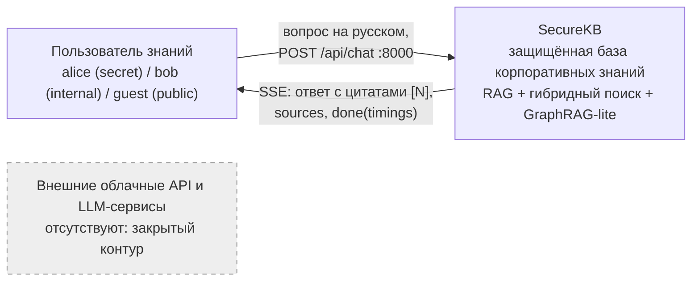
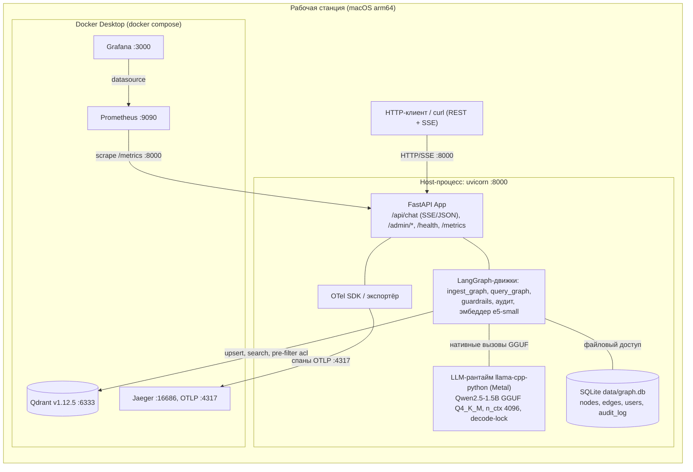
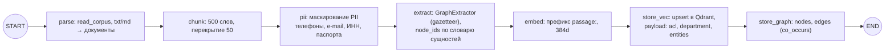
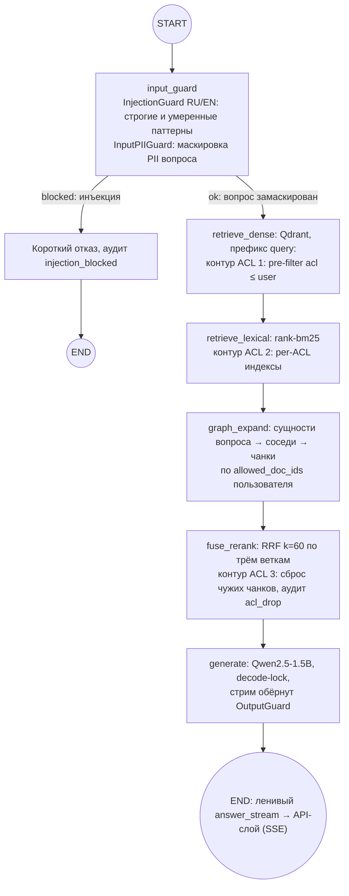
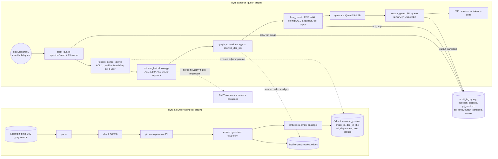
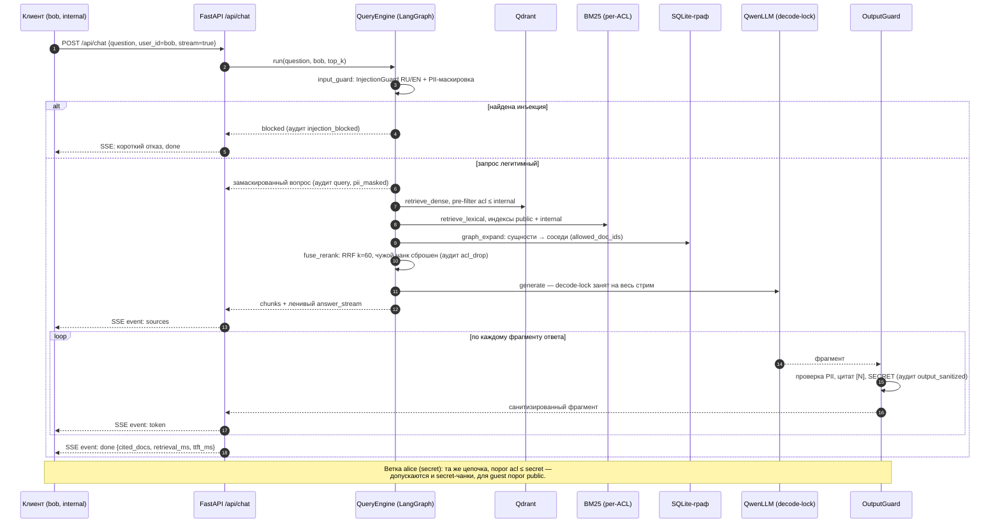
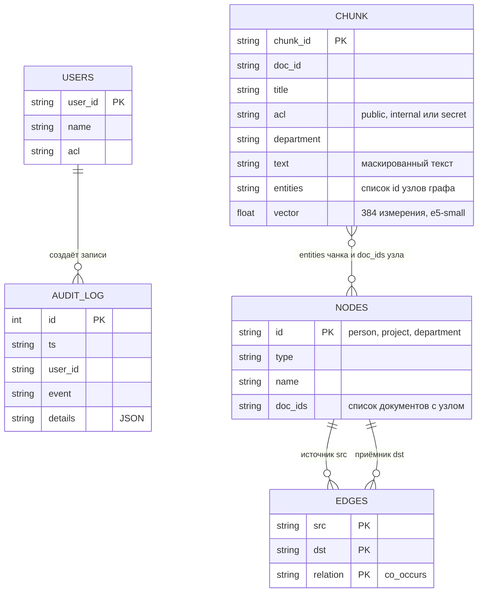
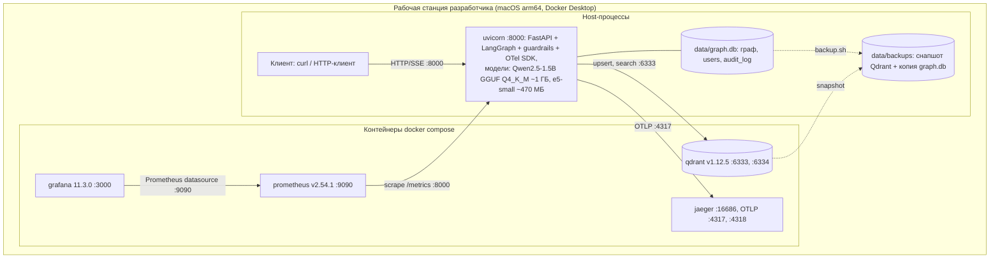
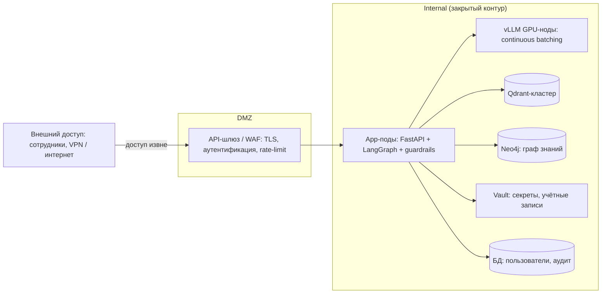

# Архитектура системы SecureKB

Архитектура защищённой базы корпоративных знаний SecureKB: RAG (Retrieval-Augmented
Generation — генерация, дополненная поиском) с гибридным
поиском, графовым расширением (GraphRAG-lite) и защитой данных на всех этапах.
Требования — `docs/01-требования.md`, план и обоснования — `docs/00-master-plan.md`,
нагрузочные испытания — `docs/04-load-report.md`. Диаграммы приведены в нотации
Mermaid и соответствуют реализованному коду; целевые, не реализованные в MVP
схемы помечены отдельно.

## 1. Обзор и принципы

SecureKB — FastAPI-приложение, оркестрируемое двумя графами LangGraph (ingest
и query). Внешние сервисы — контейнеры docker compose: Qdrant, Prometheus,
Grafana, Jaeger. Граф знаний, пользователи и аудит — один файл SQLite
(data/graph.db); инференс LLM (LLM — Large Language Model, большая языковая
модель; Qwen2.5-1.5B GGUF) и эмбеддер
(multilingual-e5-small) исполняются в процессе приложения на Apple Silicon
(Metal).

Принципы:

- Security by design: ACL (Access Control List — список контроля доступа)
  попадает в payload точки при индексации, PII (Personally Identifiable
  Information — персональные данные) маскируется до эмбеддинга, фильтры действуют
  в каждой ветке поиска.
- Defense in depth: три независимых контура ACL — pre-filter Qdrant, per-ACL
  BM25-индексы (BM25 — Best Match 25), проверка после слияния RRF (Reciprocal
  Rank Fusion — обратное ранговое слияние) — плюс выходной guardrail.
- Закрытый контур: модели и данные локальны, внешние вызовы из пути запроса
  исключены.
- MVP и целевая архитектура: llama.cpp вместо vLLM, SQLite вместо Neo4j, текст
  вместо мультимодальности (раздел 5 требований); целевые замены — в разделе 8.

## 2. Контекст системы (C4 — Context, Containers, Components, Code; уровень 1)

Единственный актор — пользователь; внешних интеграций нет, контур закрыт.

## 3. Контейнеры (C4, уровень 2)

Приложение и LLM-рантайм — host-процесс uvicorn; инфраструктура — контейнеры
`infra/docker-compose.yml`.

Связи: клиент — HTTP/SSE (SSE — Server-Sent Events, потоковая передача событий); Qdrant — REST с payload-фильтром acl; Jaeger — OTLP;
Prometheus опрашивает /metrics; Grafana читает Prometheus (дашборд securekb,
6 панелей).

## 4. Компоненты (C4, уровень 3): графы LangGraph

### 4.1. Граф ингеста

Последовательность: parse → chunk → pii → extract → embed → store_vec →
store_graph. Отличие от порядка мастер-плана: extract до store_vec, иначе
payload точки Qdrant не содержал бы найденные сущности (entities).

### 4.2. Граф запроса

После input_guard условное ребро ведёт в END (короткий отказ) либо в цепочку
поиска. Каждый узел обёрнут таймером стадии (securekb_stage_latency_seconds)
и спаном OTel (OTel — OpenTelemetry) с атрибутами user_acl, chunks_count.

## 5. Потоки данных (DFD — Data Flow Diagram, диаграмма потоков данных)

Путь документа и путь запроса: где маскируется PII, где действует каждый
контур ACL, куда пишется аудит.

Контролируемые точки: PII маскируется дважды (N3 — до индексации, G1 — на
входе); ACL проверяется трижды (G2, G3, G5) и ещё раз по цитатам на выходе;
срабатывания фильтров попадают в audit_log и метрику
securekb_guardrail_events_total.

## 6. Взаимодействие по запросу (sequence, пользователь bob)

Узкое место — узел generate: на одном llama.cpp-контексте стримы сериализованы
decode-lock, параллельные запросы выстраиваются в очередь; retrieval занимает
около 1% времени запроса (docs/04-load-report.md).

## 7. Модель данных (ER — Entity-Relationship, модель «сущность—связь»)

Qdrant хранит точки коллекции securekb_chunks (вектор + payload); SQLite —
четыре таблицы одного файла graph.db. Связи между хранилищами концептуальные:
чанк ссылается на узлы графа через entities/doc_ids, записи аудита — на
пользователей. Таблицы sessions в схеме нет — история диалогов не хранится.

Объём демонстрационных данных: 100 точек в Qdrant; 20 узлов и 276 рёбер в
SQLite; 3 пользователя; 24 находки PII замаскированы при ингесте.

## 8. Развёртывание

### 8.1. Реализованная схема (MVP)

Рабочая станция разработчика: macOS arm64, Docker Desktop; приложение и модели
— host-процесс, инфраструктура — контейнеры.

### 8.2. Целевая схема (проект, в MVP не реализована)

Перенос в контур предприятия: доступ извне только через DMZ (DMZ — Demilitarized
Zone, демилитаризованная зона), инференс — GPU-ноды
с vLLM, граф — Neo4j, секреты — Vault.

Отличия от MVP обоснованы в требованиях (раздел 5): vLLM снимает сериализацию
генерации (батч-мультиплексирование вместо очереди), Neo4j заменяет SQLite при
росте графа, DMZ и Vault закрывают периметр и управление секретами.

## 9. Control Plane и Data Plane

Интерпретация по составу (оркестрация против исполнения):

| Плоскость | Компоненты |
|---|---|
| Control Plane | LangGraph-оркестрация (ingest_graph, query_graph: порядок этапов, условные переходы), guardrails-политика (InjectionGuard, InputPIIGuard, OutputGuard), RBAC-логика (ACL, контроль в rrf_fuse), модуль аудита, административный API /admin/*, конфигурация Settings, скрипты ingest и backup.sh |
| Data Plane | Qdrant (векторы, payload), SQLite graph.db (nodes, edges, users, audit_log), LLM-рантайм llama-cpp-python, эмбеддер e5-small, BM25-индексы в памяти процесса |

Интерпретация по плоскости доступа (API-маршруты):

| Плоскость | Маршруты | Назначение |
|---|---|---|
| Control Plane | GET /admin/users, /admin/audit, /admin/stats | управление и наблюдение, вне пути пользовательского запроса |
| Data Plane | POST /api/chat (SSE/JSON) | обработка пользовательских запросов |
| Служебные | GET /health, GET /metrics | проверки живости, экспорт метрик для Prometheus |

## 10. Механизмы безопасности

Guardrails-конвейер (backend/app/security/guardrails.py): каждый фильтр решает
одну задачу и имеет явную зону ответственности.

| Guardrail | Точка применения | Назначение | Что не проверяет |
|---|---|---|---|
| InjectionGuard | вход, до поиска | бинарный вердикт по паттернам RU/EN: блок при одном строгом (ignore instructions, system prompt, jailbreak, DAN) или двух умеренных срабатываниях (act as, «представь что ты», developer mode, повторяющиеся роли) | не маскирует PII и не проверяет ответ LLM; ложные срабатывания допустимы только как исключение |
| InputPIIGuard | вход, после InjectionGuard | PII пользователя не попадает в контекст, логи и эмбеддинги; тот же словарь паттернов, что при ингесте | не блокирует запрос (PII в вопросе — не атака), не детектирует инъекции |
| OutputGuard | выход, стрим после генерации | перехватывает утечки модели: цитату недопустимого источника [N], повтор PII из контекста, копирование маркера SECRET; санитизация на лету | не решает, пускать ли запрос (вход уже проверен), не фильтрует ветки поиска |

Три контура контроля ACL (какой чанк попадает в кандидаты):

| Контур | Узел | Механизм | Покрытие |
|---|---|---|---|
| 1 | retrieve_dense | pre-filter Qdrant: MatchAny по уровням acl не выше уровня пользователя | векторная ветка не возвращает чужие чанки |
| 2 | retrieve_lexical | отдельные BM25-индексы на каждый уровень ACL, поиск только по доступным | лексическая ветка физически разделена по уровням |
| 3 | fuse_rerank | финальная проверка после RRF: чанки с уровнем выше пользовательского сбрасываются (аудит acl_drop, метрика guardrail) | страховка на случай ошибки в любой ветке — defense in depth |

Графовая ветка подчинена тому же правилу: graph_expand выбирает соседей только
по allowed_doc_ids пользователя. Все срабатывания фильтров фиксируются в
audit_log и в метрике securekb_guardrail_events_total(kind). Эффективность
подтверждена red-team-набором: 10 инъекций блокированы, 8 легитимных вопросов
пропущены.
