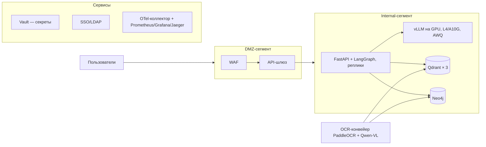

# Целевая архитектура и план перехода из MVP

Основа: отступления О-1…О-4 из мастер-плана (§1) и вывод отчёта 04 — узкое место MVP (Minimum Viable Product — минимально жизнеспособный продукт): one-process llama.cpp с сериализацией генерации; retrieval-стек насыщения не создаёт.

## 1. Разрыв между MVP и целевой архитектурой

Усилие: S — до недели, M — 2–4 недели, L — свыше месяца (оценка для одного инженера).

| Компонент | MVP | Целевая | Зачем менять | Усилие |
|---|---|---|---|---|
| LLM-инференс | llama.cpp GGUF (GPT-Generated Unified Format) Q4_K_M, one-process, decode-lock | vLLM + AWQ на GPU | Убрать сериализацию: continuous batching, рост RPS (Requests Per Second — запросов в секунду) на порядки | L |
| GPU | Apple Silicon (MPS/Metal), унифицированная память | NVIDIA L4/A10G 24 ГБ | vLLM требует CUDA; запас под 7B в AWQ (Activation-aware Weight Quantization) и VLM | M |
| Граф знаний | SQLite, rule-based экстракция, 4 типа узлов | Neo4j + LLM-экстракция сущностей и связей | Сложные связи, многошаговые запросы, масштаб графа (О-3) | L |
| Векторная БД | Qdrant single-node (Docker) | Qdrant-кластер (3 узла) | Отказоустойчивость, шардирование коллекций | M |
| Секреты | `.env` | Vault | Централизованное хранение, ротация, аудит доступа | S |
| Периметр | localhost, docker compose | DMZ (Demilitarized Zone — демилитаризованная зона): API-шлюз + WAF (Web Application Firewall) | Публикация в корпоративной сети, фильтрация трафика | M |
| Идентификация | `user_id` из запроса (доверенный) | SSO (Single Sign-On — единая точка входа)/LDAP → JWT | Реальная аутентификация, централизованное управление ролями | M |
| Мультимодальность | текст txt/md | PaddleOCR + Qwen-VL | Сканы, чертежи, PDF с изображениями — требование ТЗ (О-1) | M |
| Деплой | docker compose, один хост | K8s + Helm | Реплики, rolling update, самовосстановление | L |
| Наблюдаемость | Prometheus/Grafana/Jaeger | + метрики vLLM, алерты TTFT (Time To First Token — время до первого токена)/GPU | Контроль нового инференс-слоя | S |
| HA | один инстанс всего | Реплики app/vLLM, кластеры БД | SLA доступности | L |

## 2. Целевая схема (кратко; детализация — docs/02-architecture.md)

Принцип: сегментация (DMZ/Internal), секреты и аутентификация — вне приложения, инференс — заменяемый слой за стабильным протоколом.

Потоки: APIGW терминирует TLS и проверяет JWT; app обращается к vLLM и БД только по внутренней сети; Vault и SSO/LDAP образуют управляющий контур (Control Plane), путь запроса (Data Plane) их не пересекает.

## 3. Дорожная карта

Сводная таблица фаз (метрики — из отчётов 03/04, цели-оценки):

| Фаза | Горизонт | Метрика входа | Критерий выхода |
|---|---|---|---|
| 0 — MVP | завершена | — | готово: RPS 0,27, TTFT p50 3,08 с, 0 ошибок |
| 1 — vLLM+GPU, Vault, SSO | 4–8 нед | потолок 0,27 RPS, decode-lock | RPS ≥ 10, TTFT p50 ≤ 0,5 с при c=4 |
| 2 — Neo4j, OCR | 2–4 мес | GraphRAG-lite, только текст | ablation подтверждает вклад графа |
| 3 — K8s, мультитенантность, HA | далее | один инстанс всего | rolling update без простоя |

**Фаза 0 — MVP (завершена).** Рабочий конвейер ingestion+query, RBAC (Role-Based Access Control — доступ по ролям) на чанках, guardrails, golden-тесты, нагрузочный замер: 0 ошибок, RPS 0,234–0,270, TTFT p50 3,08 с (c=1); узкое место — LLM-prefill. Все точки отказа известны и описаны.

**Фаза 1 — «Убрать потолок» (4–8 недель).**
- Цель: заменить инференс на vLLM+GPU, закрыть базовые корпоративные требования.
- Работы: GPU-стенд (аренда, сценарий A из 05-tco); развёртывание vLLM с AWQ-моделью; адаптер инференса за OpenAI-совместимым протоколом; миграция секретов в Vault; SSO/LDAP → JWT вместо доверенного `user_id`.
- Критерии входа: потолок MVP 0,27 RPS, decode-lock (отчёт 04). Критерии выхода: RPS ≥ 10 на одной ноде и TTFT p50 ≤ 0,5 с при c=4 (цели-оценки); отсутствие блокировок генерации; секреты вне `.env`; аутентификация через корпоративный SSO; golden-тесты зелёные.
- Риски: сроки аренды/закупки GPU; качество AWQ-квантования (проверка по golden Q/A); организационная интеграция SSO.

**Фаза 2 — «Граф и документы» (2–4 месяца).**
- Цель: полноценный GraphRAG и вход в мультимодальность.
- Работы: миграция графа в Neo4j; LLM-экстрактор сущностей и связей (онтология из MVP как старт); контроль качества экстракции; конвейер PaddleOCR; индексация сканов и PDF.
- Критерии готовности: ablation-тест подтверждает вклад графа (иначе откат на GraphRAG-lite); golden Q/A не хуже MVP; скан → текст → чанк ≤ 2 мин/документ (оценка); покрытие мультимодальных форматов из ТЗ.
- Риски: галлюцинации экстракции (валидация онтологией, выборочный ручной контроль); рост латентности ingestion; качество OCR на чертежах.

**Фаза 3 — «Эксплуатация в масштабе» (далее).**
- Цель: производительная эксплуатация на компанию.
- Работы: Helm-чарты, K8s; реплики app и vLLM; Qdrant-кластер; мультитенантность (изолированные коллекции/пространства имён); публикация через DMZ (APIGW/WAF); HA.
- Критерии готовности: rolling update без простоя; отказ узла — деградация, не остановка; p95 в целевом SLA; алерты по TTFT/GPU.
- Риски: сложность эксплуатации и рост TCO (Total Cost of Ownership — совокупная стоимость владения; см. 05); необходимость выделенной роли SRE; согласование периметра со службой ИБ.

## 4. Что сознательно НЕ меняем

- **Ядро FastAPI + LangGraph**: оба графа (ingestion, query) — стабильная оркестрация; смена инференса не касается логики конвейера. ADR-003 (ADR — Architecture Decision Record, запись об архитектурном решении) зафиксировал этот выбор против линейного пайплайна и LlamaIndex.
- **Guardrails-контур**: input/output-фильтры, маскирование PII (Personally Identifiable Information — персональные данные), ACL (Access Control List — список контроля доступа) pre-filter на retrieval — не зависят от модели и инференс-стека.
- **Golden-тесты и FakeLLM**: проверяют поведение конвейера без реального инференса; перенос на vLLM — заменой одного адаптера по тому же протоколу `LLM`. Это страховка фаз 1–3: регрессия выявляется до выпуска.
- **Стек наблюдаемости**: Prometheus/Grafana/Jaeger уже в пути каждого запроса; расширяется метриками vLLM, а не заменяется.
- **Модель затрат на ПО**: весь стек остаётся open-source, лицензионные затраты = 0 при любом сценарии из 05-tco.

Итог: переход MVP → целевая архитектура — это замена инфраструктурного слоя вокруг стабильного ядра, а не переписывание продукта.
